# Домашнее задание 1: PostgreSQL в Docker

## Цель
Развернуть PostgreSQL в Docker с внешним подключением и устойчивым хранением данных (volume) для воспроизводимого тестового стенда.

## Ход выполнения

### 1. Подготовка среды
Установлен Docker Engine на ВМ с Ubuntu 24.04 (сервер Aeza). Создан каталог для данных на хосте и выданы права пользователю postgres (UID 999), чтобы контейнер мог писать данные:

```bash
sudo mkdir -p /var/lib/postgresql_docker
sudo chown -R 999:999 /var/lib/postgresql_docker
```

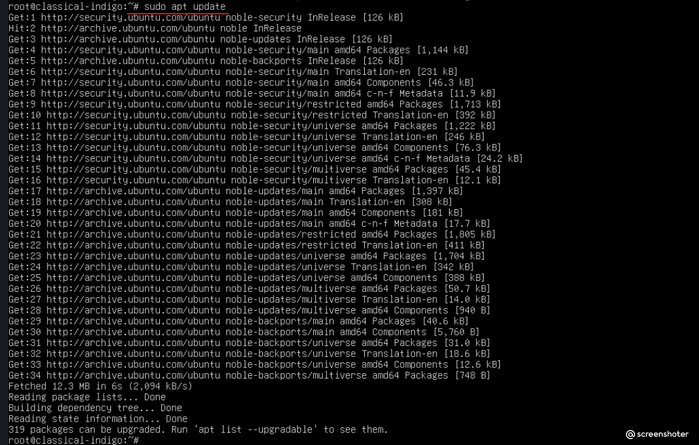

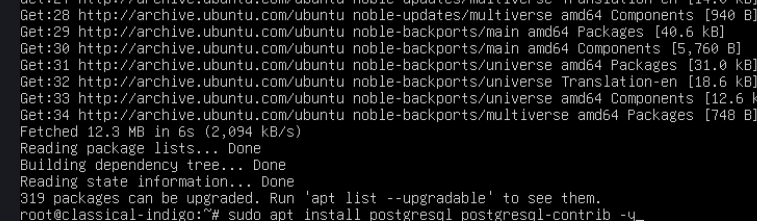

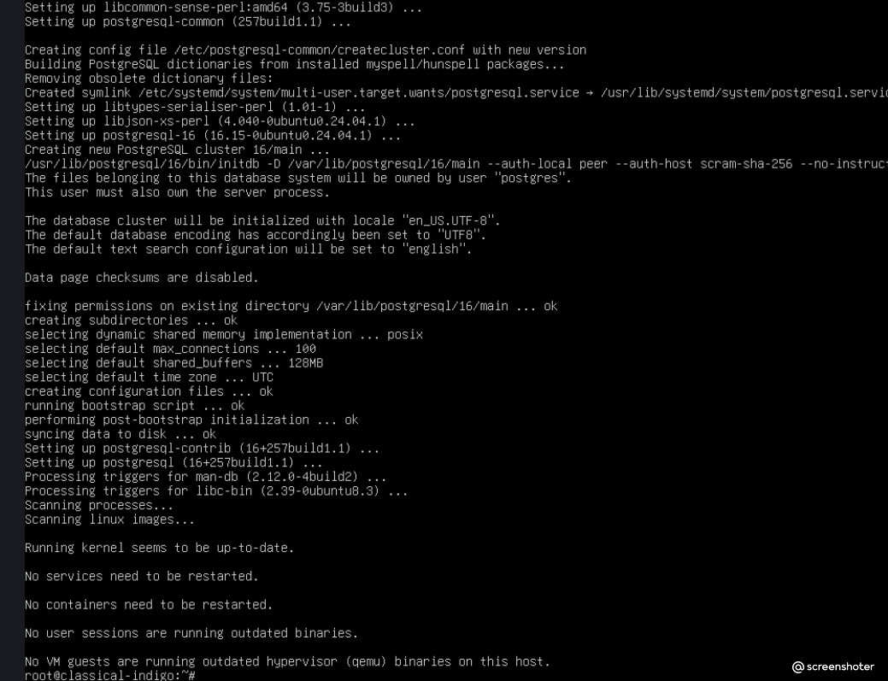

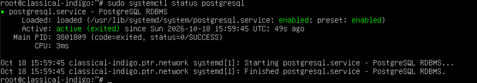

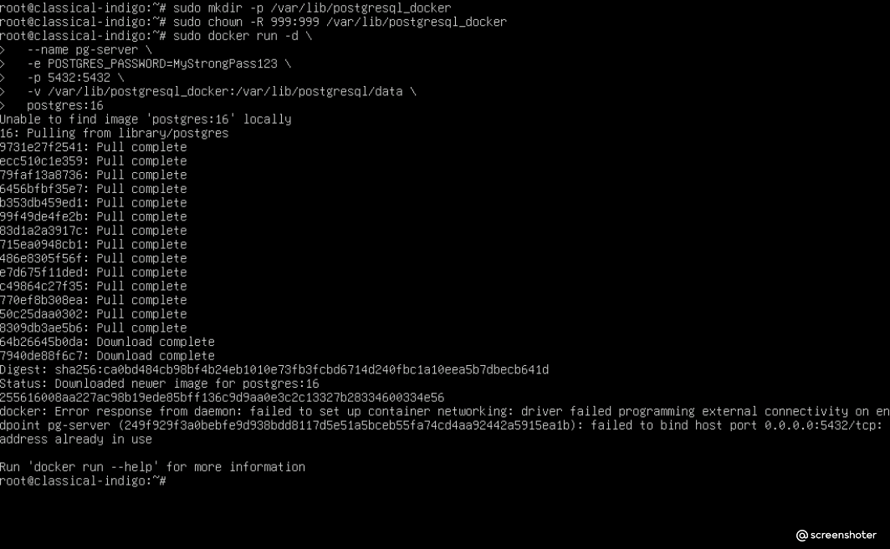

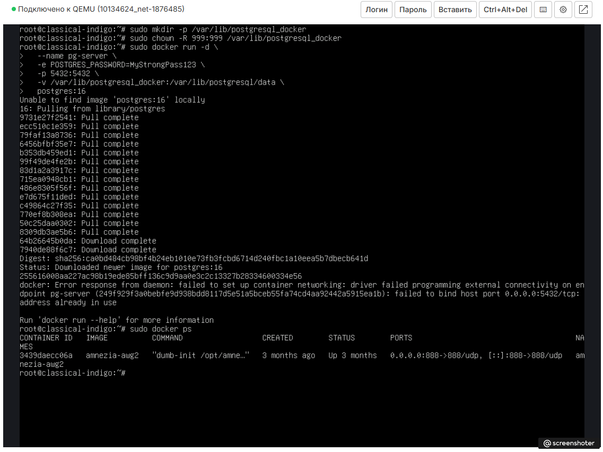

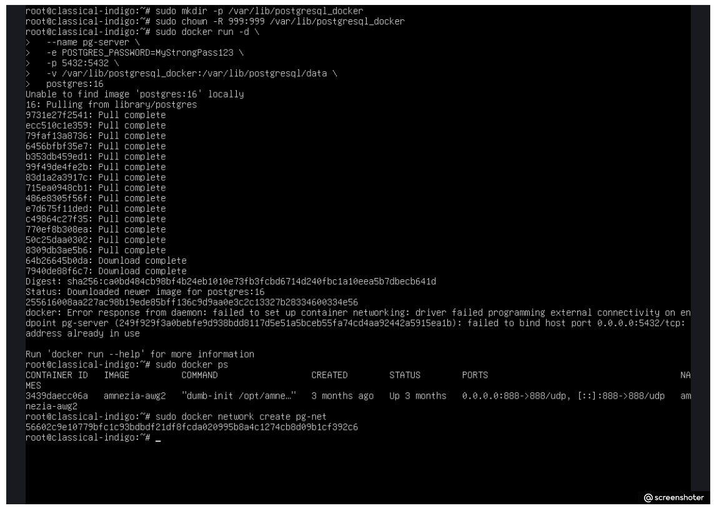

### 2. Запуск сервера PostgreSQL
Создана сеть `pg-net` для связи контейнеров. Запущен контейнер с сервером, проброшен порт 5432 и смонтирован volume:

```bash
sudo docker network create pg-net

sudo docker run -d \
  --name pg-server \
  --network pg-net \
  -e POSTGRES_PASSWORD=MyStrongPass123 \
  -p 5432:5432 \
  -v /var/lib/postgresql_docker:/var/lib/postgresql/data \
  postgres:16
```

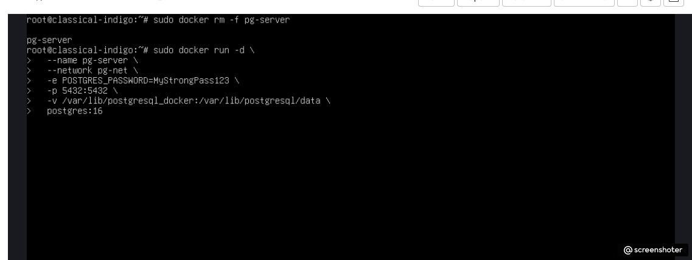

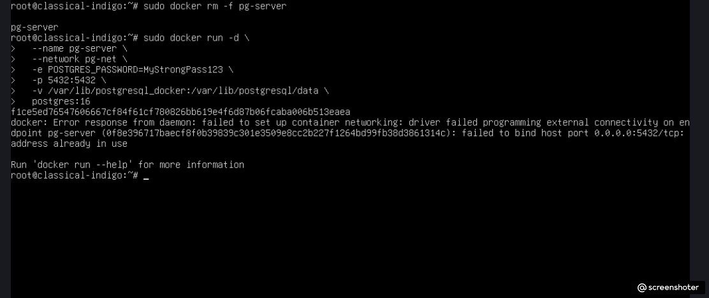

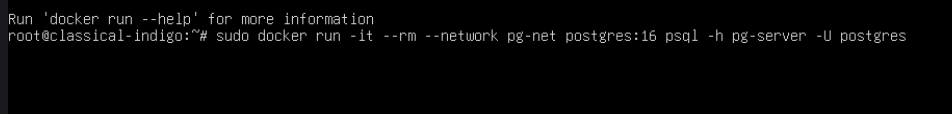

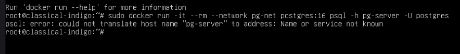

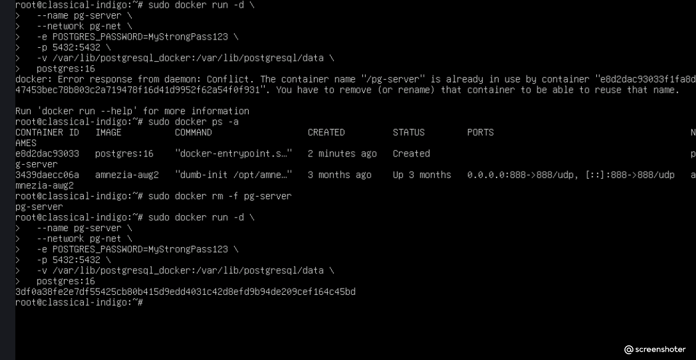

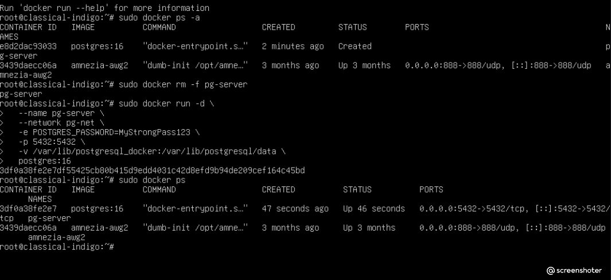

### 3. Подключение из контейнера-клиента и создание данных
Запущен временный контейнер с `psql`, подключен к серверу по имени `pg-server`. Выполнены SQL-команды для создания таблицы `orders_test` и вставки двух строк:

```sql
CREATE TABLE orders_test (
    id SERIAL PRIMARY KEY,
    customer_name VARCHAR(100),
    amount DECIMAL(10, 2)
);

INSERT INTO orders_test (customer_name, amount) 
VALUES 
    ('Ivan Petrov', 1500.00), 
    ('Maria Sidorova', 2750.50);
```

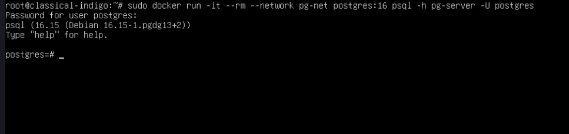

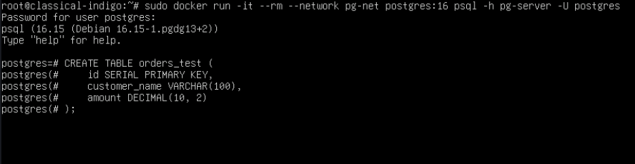

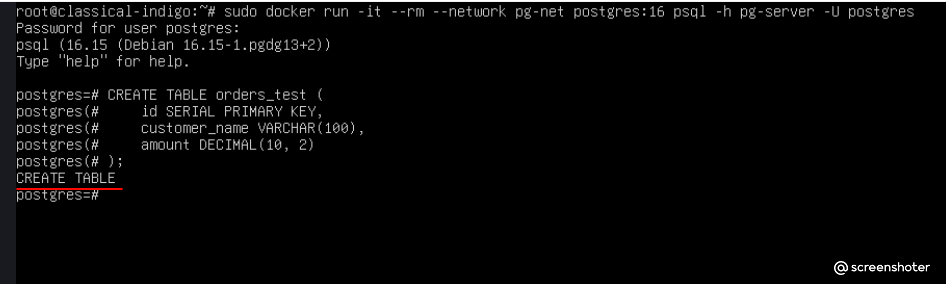

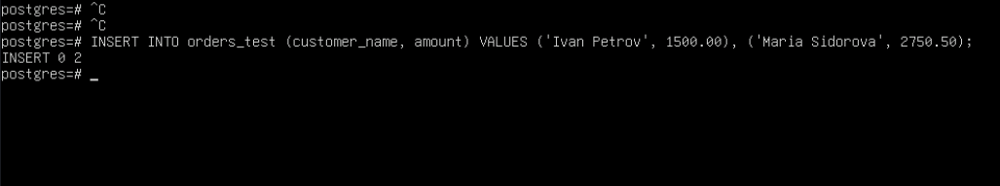

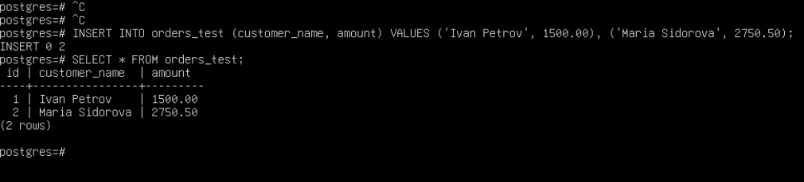

### 4. Подключение извне (с рабочего компьютера)
На Windows 11 установлен pgAdmin 4. Настроено подключение к серверу Aeza по внешнему IP-адресу и порту 5432. Выполнен проверочный запрос `SELECT * FROM orders_test;`, данные успешно получены.

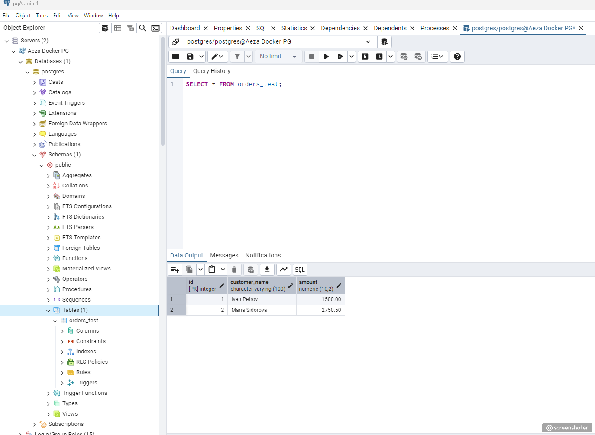

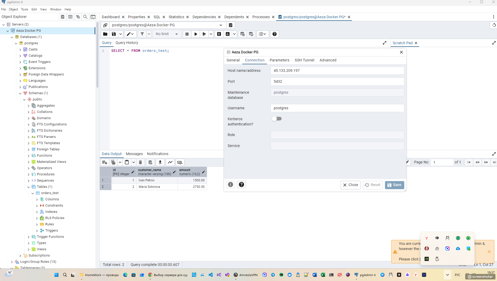

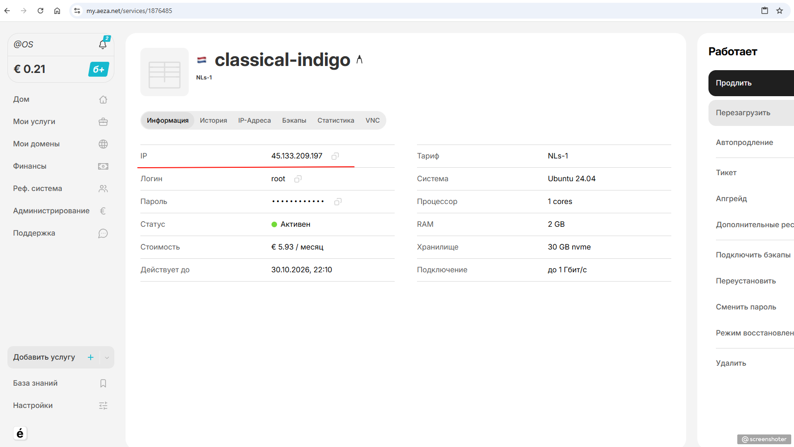

### 5. Проверка сохранности данных
Контейнер `pg-server` был остановлен и удален:

```bash
sudo docker rm -f pg-server
```

Затем контейнер создан заново с использованием того же каталога `/var/lib/postgresql_docker`:

```bash
sudo docker run -d \
  --name pg-server \
  --network pg-net \
  -e POSTGRES_PASSWORD=MyStrongPass123 \
  -p 5432:5432 \
  -v /var/lib/postgresql_docker:/var/lib/postgresql/data \
  postgres:16
```

Проверка данных из контейнера-клиента показала, что строки сохранились:

```bash
sudo docker run -it --rm --network pg-net postgres:16 psql -h pg-server -U postgres -c "SELECT * FROM orders_test;"
```

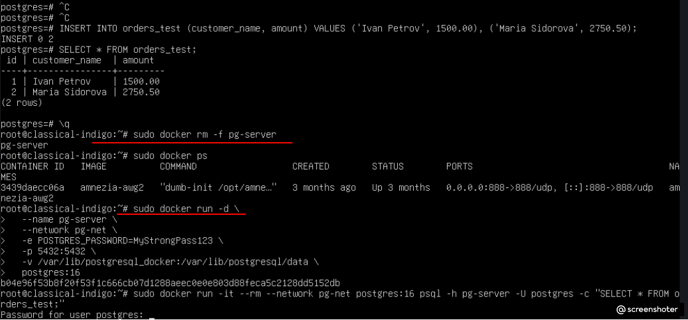

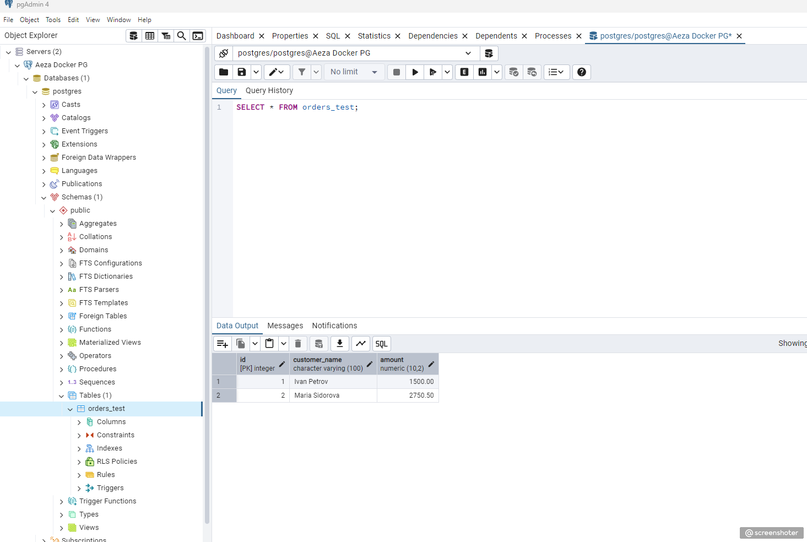

## Решенные проблемы (Troubleshooting)
В ходе выполнения возникли следующие сложности:

* **Конфликт портов:** При запуске контейнера возникла ошибка *address already in use* (порт 5432). Выяснилось, что на хосте ранее был установлен локальный PostgreSQL. Проблема решена остановкой службы: `sudo systemctl stop postgresql`.
* **Конфликт имен контейнеров:** Ошибка *Conflict. The container name "/pg-server" is already in use*. Решено удалением старого контейнера перед созданием нового: `sudo docker rm -f pg-server`.
* **Проблема с кодировкой:** При вводе данных на кириллице в консоли `psql` появлялись «крякозябры». Для стабильной работы данные вставлены латиницей (*Ivan Petrov*, *Maria Sidorova*).
