# Домашнее задание 2: Перенос данных PostgreSQL

## Цель
Перенести каталог данных PostgreSQL на дополнительный диск и восстановить работоспособность кластера при нехватке места на системном диске.

## Ход выполнения

### 1. Установка и проверка PostgreSQL
PostgreSQL 16 уже был установлен на ВМ (Ubuntu 24.04). Проверена работа кластера и его статус.

```bash
sudo apt update
sudo apt install postgresql postgresql-contrib -y
pg_lsclusters
```

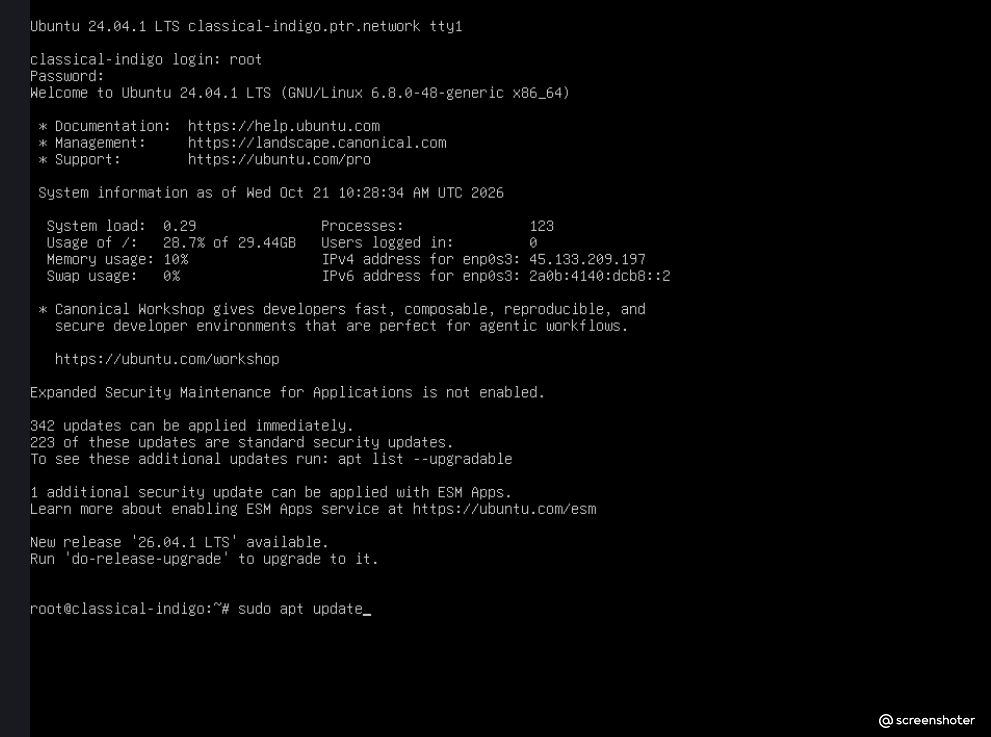

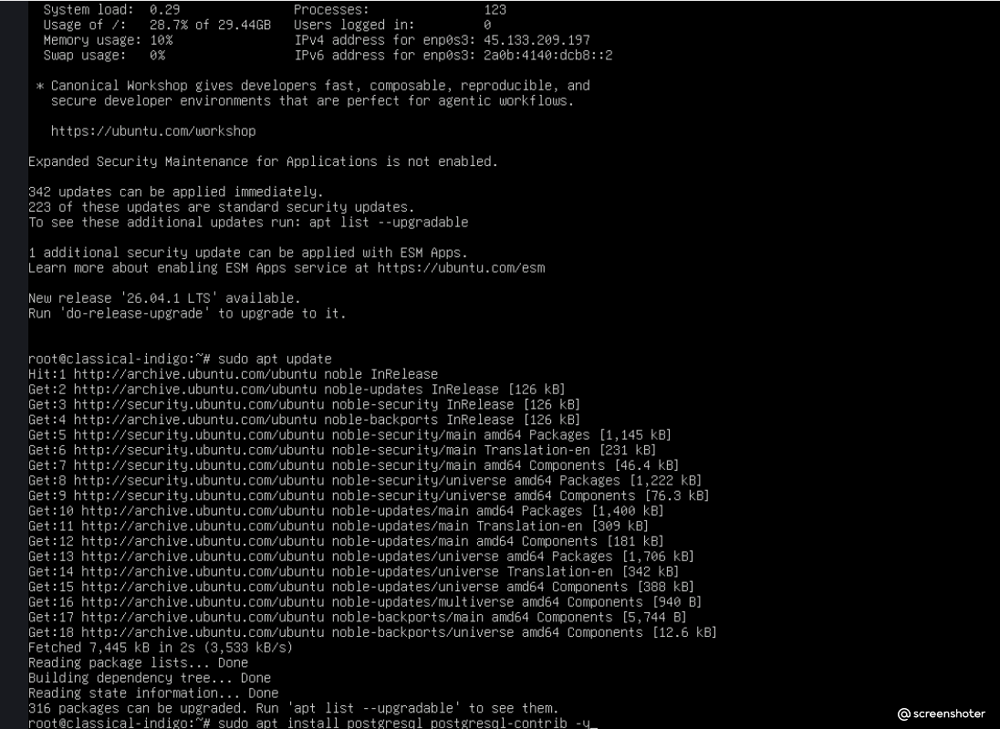

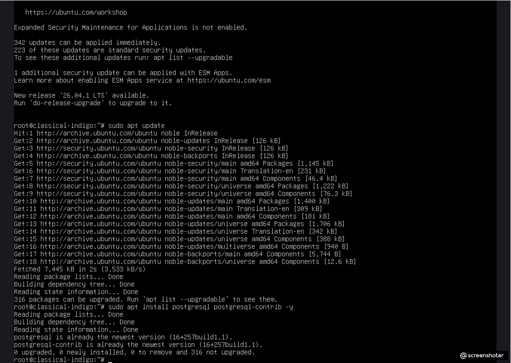


### 2. Создание тестовой таблицы
Под пользователем postgres создана таблица test и добавлены две строки.

```bash
CREATE TABLE test (
    id SERIAL PRIMARY KEY,
    name VARCHAR(50)
);
INSERT INTO test (name) VALUES ('Row 1'), ('Row 2');
```

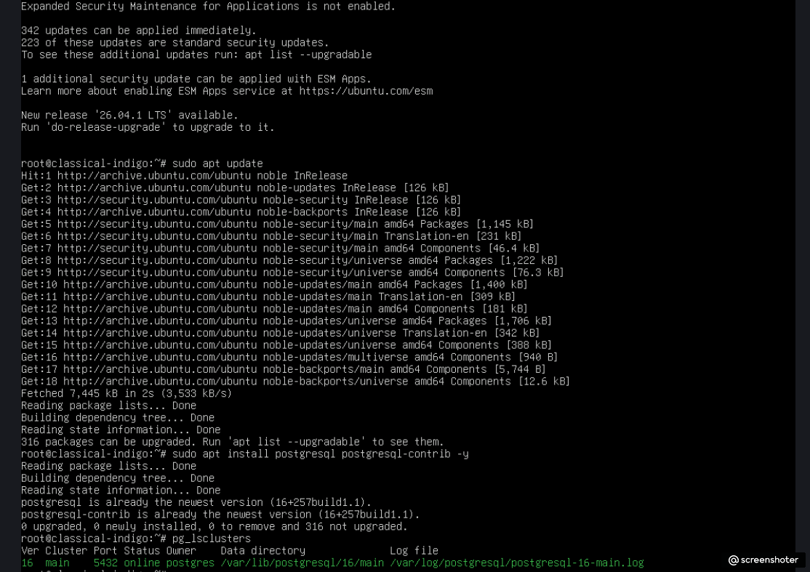

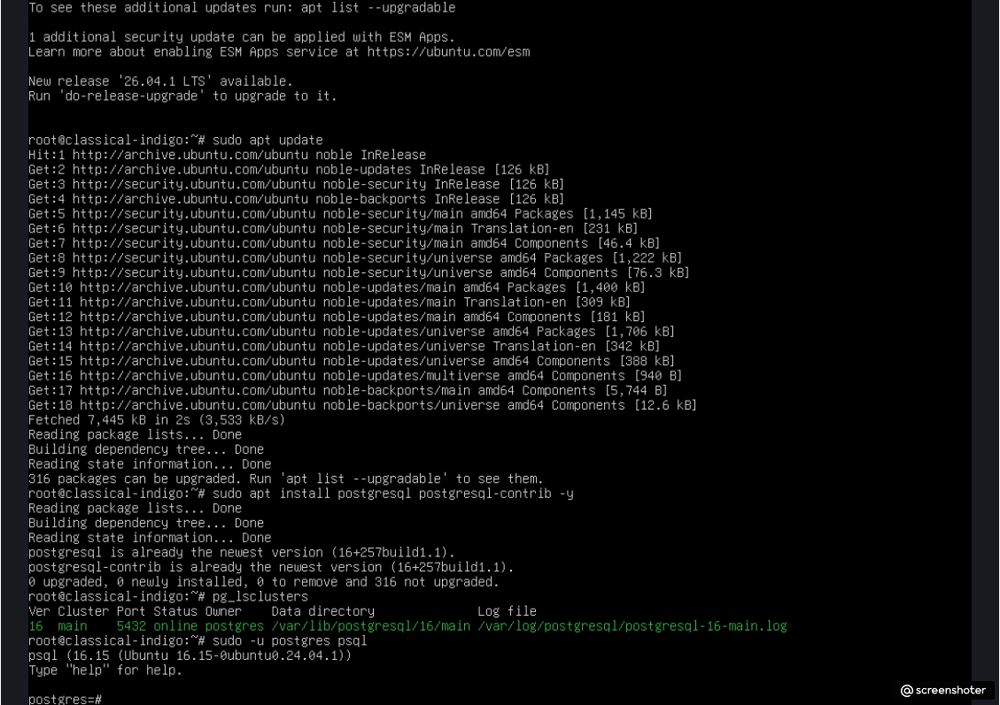

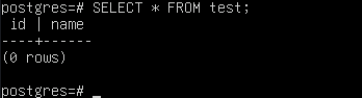

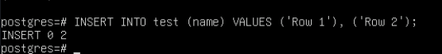

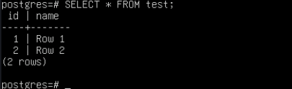


### 3. Остановка кластера
Кластер PostgreSQL остановлен штатной командой перед переносом данных.

```bash
sudo pg_ctlcluster 16 main stop
pg_lsclusters
```

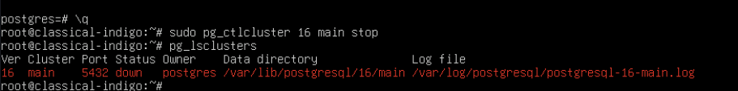


### 4. Создание дополнительного диска (Loop-устройство)
Важное примечание: В панели управления Aeza отсутствует возможность подключения дополнительного физического диска (доступно только расширение основного). Для выполнения задания был создан виртуальный loop-диск размером 10 ГБ, который эмулирует физический носитель.

```bash
sudo fallocate -l 10G /disk10.img
sudo losetup -fP /disk10.img
```

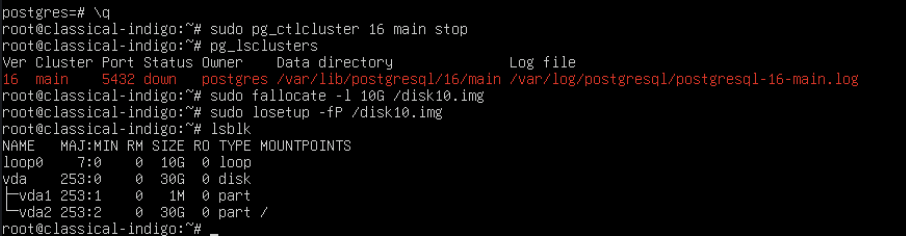

### 5. Разметка, форматирование и монтирование
Диск отформатирован в ext4 и примонтирован в /mnt/data. Настроено автомонтирование через /etc/fstab.

```bash
sudo mkfs.ext4 /dev/loop0
sudo mkdir -p /mnt/data
sudo mount /dev/loop0 /mnt/data
# Добавление в fstab: /dev/loop0 /mnt/data ext4 defaults 0 2
sudo mount -a
df -h /mnt/data
```

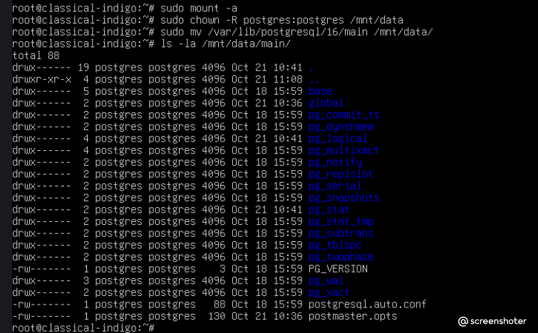

### 6. Перенос каталога данных и назначение прав
Каталог данных перенесен на новый диск, права назначены пользователю postgres.

```bash
sudo chown -R postgres:postgres /mnt/data
sudo mv /var/lib/postgresql/16/main /mnt/data/
```

### 7. Изменение конфигурации (data_directory)
В файле /etc/postgresql/16/main/postgresql.conf изменен параметр data_directory.
Проблема и решение: При первой попытке был использован обратный слеш (\mnt\data\main), что вызвало ошибку invalid line 43. Путь был исправлен на прямой слеш (/mnt/data/main).

Было:
data_directory = '/var/lib/postgresql/16/main'
Стало:
#data_directory = '/var/lib/postgresql/16/main'
data_directory = '/mnt/data/main'

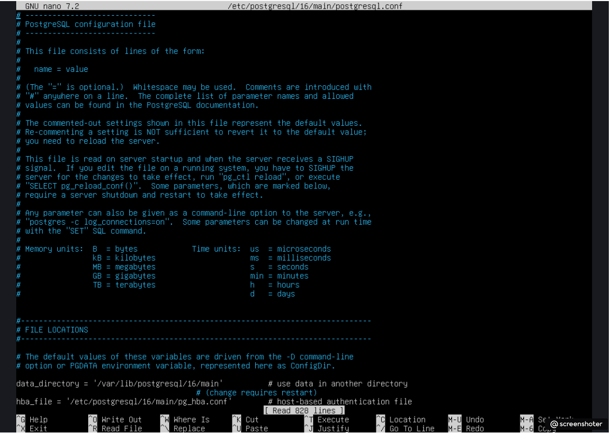

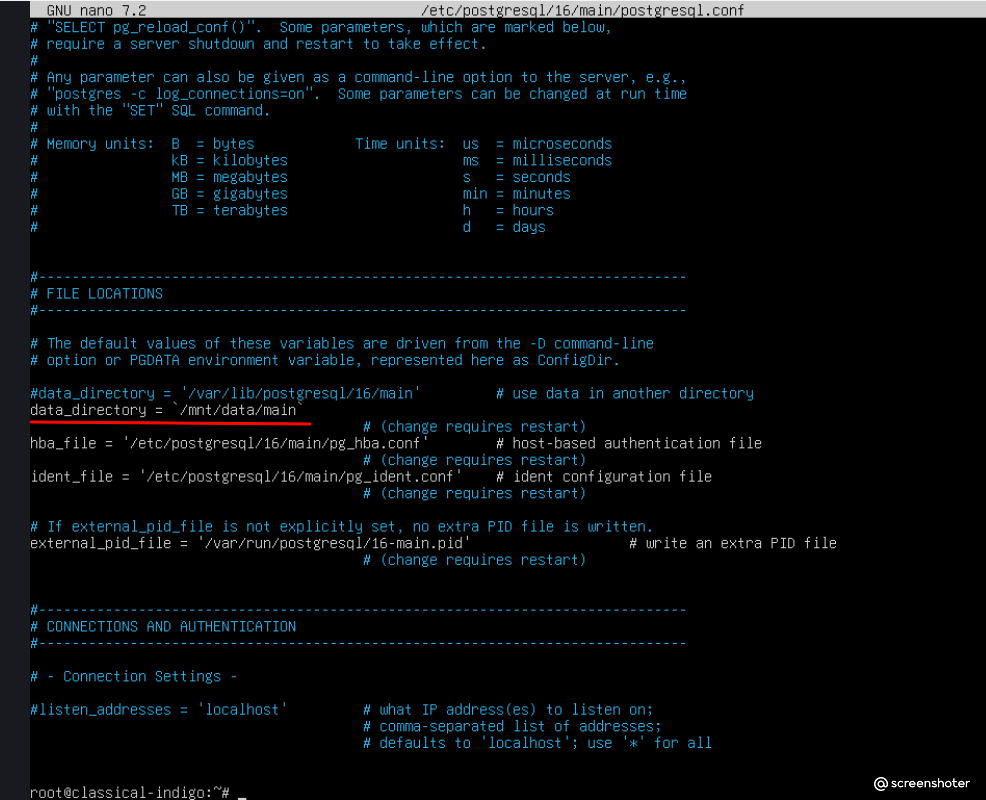

### 8. Запуск кластера и проверка данных
После исправления конфигурации кластер успешно запустился. Данные таблицы test сохранились.

```bash
sudo pg_ctlcluster 16 main start
pg_lsclusters
sudo -u postgres psql -c "SELECT * FROM test;"
```

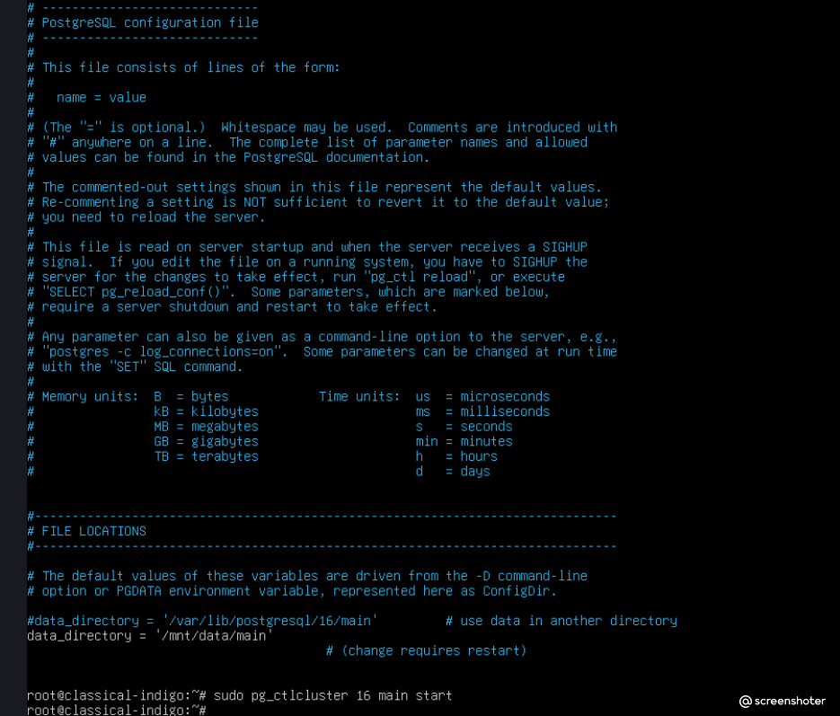

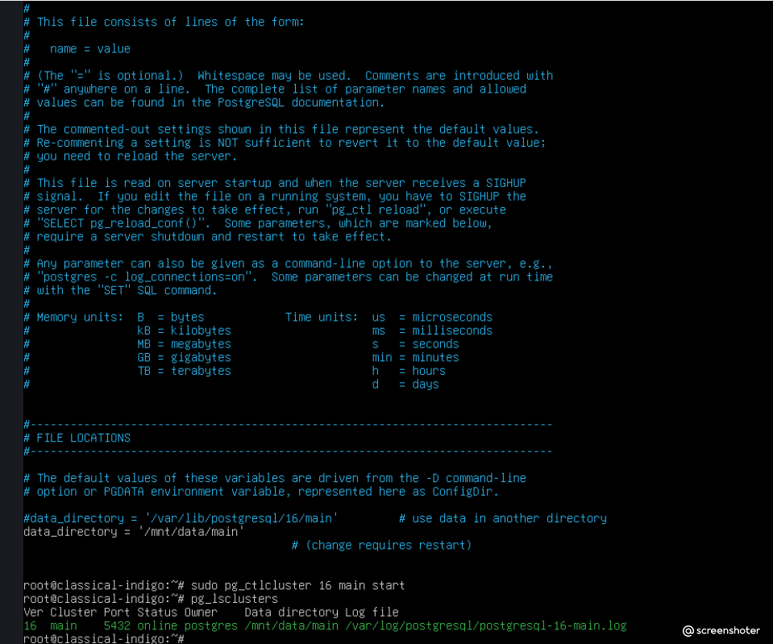

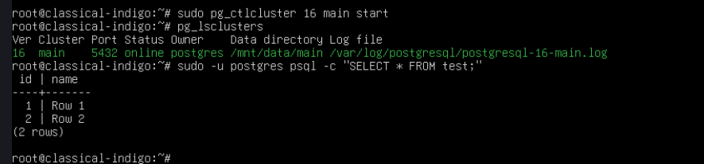


## Решенные проблемы (Troubleshooting)
Отсутствие возможности подключить физический диск: В панели Aeza нельзя добавить отдельный диск. Решение: создан loop-диск (/disk10.img), эмулирующий физический носитель.

Ошибка синтаксиса в postgresql.conf: При указании пути data_directory был использован обратный слеш (\), что привело к ошибке запуска. Решение: путь исправлен на прямой слеш (/).

Автомонтирование loop-диска: Так как loop-устройства не монтируются автоматически после перезагрузки без дополнительных скриптов, запись в /etc/fstab была добавлена для выполнения задания, но в отчете отмечено, что для постоянного использования потребуется настройка скрипта инициализации.

