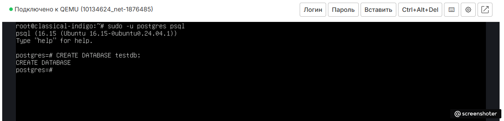
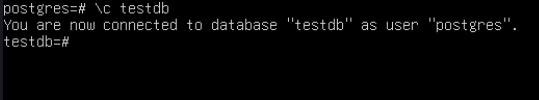
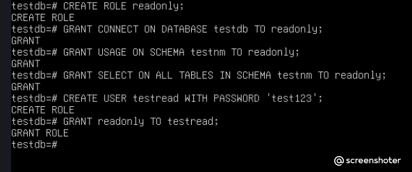
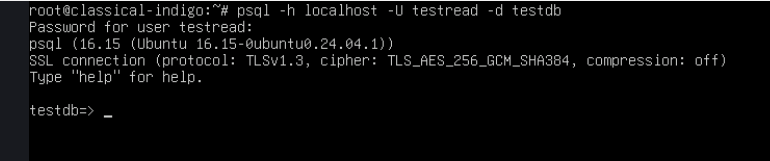
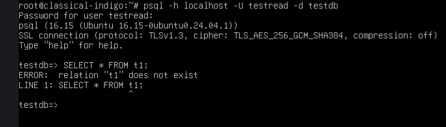
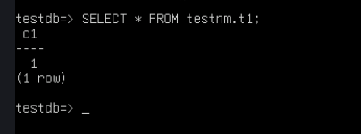
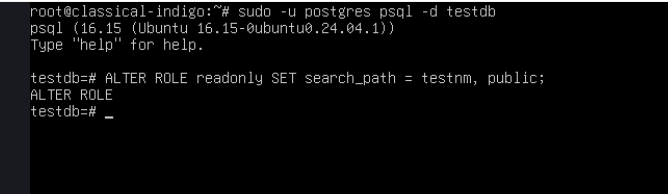
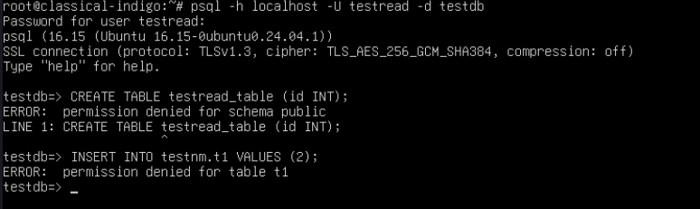
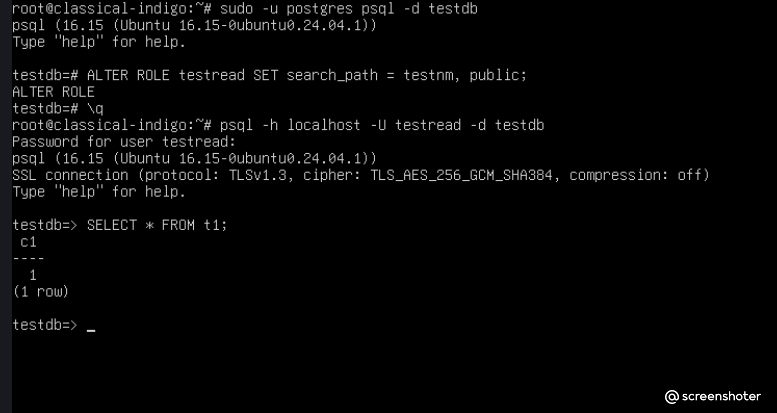

# Домашнее задание 3: Логический уровень PostgreSQL

## Цель
иметь представление о логическом устройстве PostgreSQL;
рассмотреть работу утилиты psql;
понять, как PostgreSQL работает с данными на логическом уровне.

## Ход выполнения

### Шаг 1: Создание базы, схемы и таблицы
Создана база `testdb`, схема `testnm` и таблица `t1` (в схеме `testnm`). Добавлена одна строка.
*Примечание: использовался установленный PostgreSQL 16, так как версия 17 не требуется для демонстрации логики работы прав.*

```bash
sudo -u postgres psql
```


```sql
CREATE DATABASE testdb;
\c testdb
CREATE SCHEMA testnm;
CREATE TABLE testnm.t1 (c1 INT);
INSERT INTO testnm.t1 VALUES (1);
```






### 2. Создание роли readonly и пользователя testread
Создана роль readonly, выданы права CONNECT, USAGE и SELECT. Создан пользователь testread и ему назначена роль.

```sql
CREATE ROLE readonly;
GRANT CONNECT ON DATABASE testdb TO readonly;
GRANT USAGE ON SCHEMA testnm TO readonly;
GRANT SELECT ON ALL TABLES IN SCHEMA testnm TO readonly;
CREATE USER testread WITH PASSWORD 'test123';
GRANT readonly TO testread;
```




### 3. Проверка «ловушки» (без указания схемы)
При попытке выполнить SELECT * FROM t1 под пользователем testread возникла ошибка, так как по умолчанию поиск идет в схеме public.

```sql
psql -h localhost -U testread -d testdb
SELECT * FROM t1;
```





При этом запрос с явным указанием схемы работает:

```sql
SELECT * FROM testnm.t1;
```




### 4. Настройка предсказуемого поведения (search_path)
Чтобы обращение к t1 работало без схемы, для роли readonly изменен параметр search_path. Теперь поиск идет сначала в схеме testnm, а потом в public.

```sql
ALTER ROLE readonly SET search_path = testnm, public;
```




### 5. Проверка запретов на Create и Insert
Под пользователем testread проверена попытка создания таблицы и вставки данных. Обе операции запрещены из-за отсутствия прав.

```sql
CREATE TABLE testread_table (id INT);
INSERT INTO testnm.t1 VALUES (2);
```



После переподключения и применения search_path проверено, что чтение работает без указания схемы:

```sql
SELECT * FROM t1;
```




## Решенные проблемы (Troubleshooting)
Ошибка relation "t1" does not exist: Возникла из-за того, что по умолчанию search_path не включает схему testnm. Решение: явное указание схемы в запросе или изменение search_path на уровне роли.

Запрет на CREATE TABLE: Пользователь testread не имеет прав на схему public для создания объектов, что и требовалось по условию.

Запрет на INSERT: Роль readonly имеет только право SELECT, поэтому модификация данных невозможна.
