# Домашнее задание 5: Изоляция транзакций

## Цель
Обосновать выбор уровня изоляции PostgreSQL для согласованного построения отчётов при параллельной записи данных.

## Ход выполнения

### 1. Подготовка окружения и настройка SSH
Перед началом тестирования был настроен и запущен SSH-сервер на виртуальной машине для обеспечения удаленного доступа.

*   В процессе настройки конфигурации `openssh-server` было выбрано сохранение локальной версии файла конфигурации (`keep the local version currently installed`).
    
    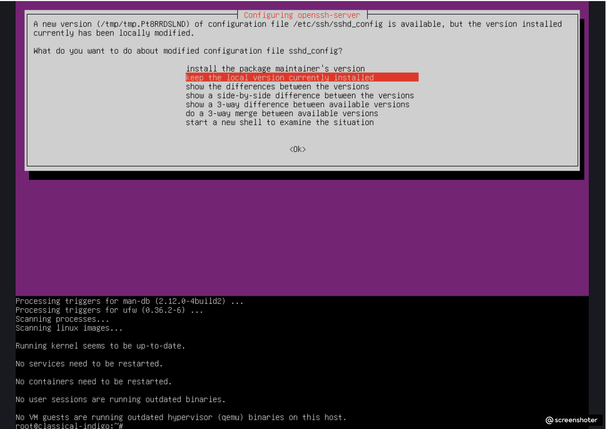

*   Служба SSH была добавлена в автозапуск и успешно запущена на кастомном порту `1978`. Проверка утилитой `ss` подтвердила активное состояние сокета на чтение (`LISTEN`).
    
    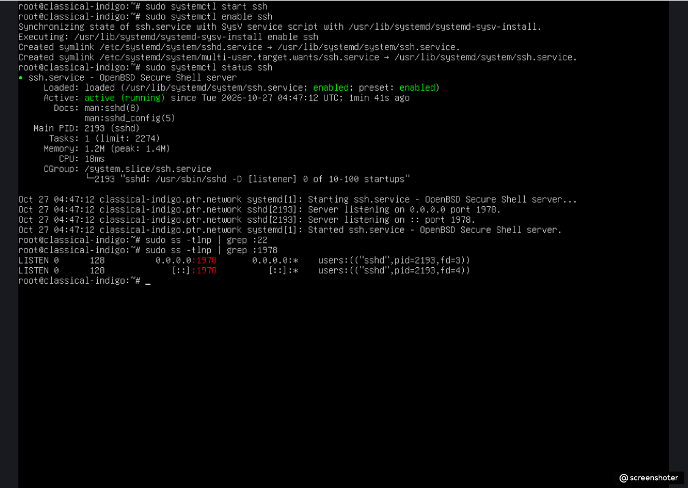

*   Выполнено успешное удаленное подключение к хосту по SSH с локальной машины через порт `1978`.
    
    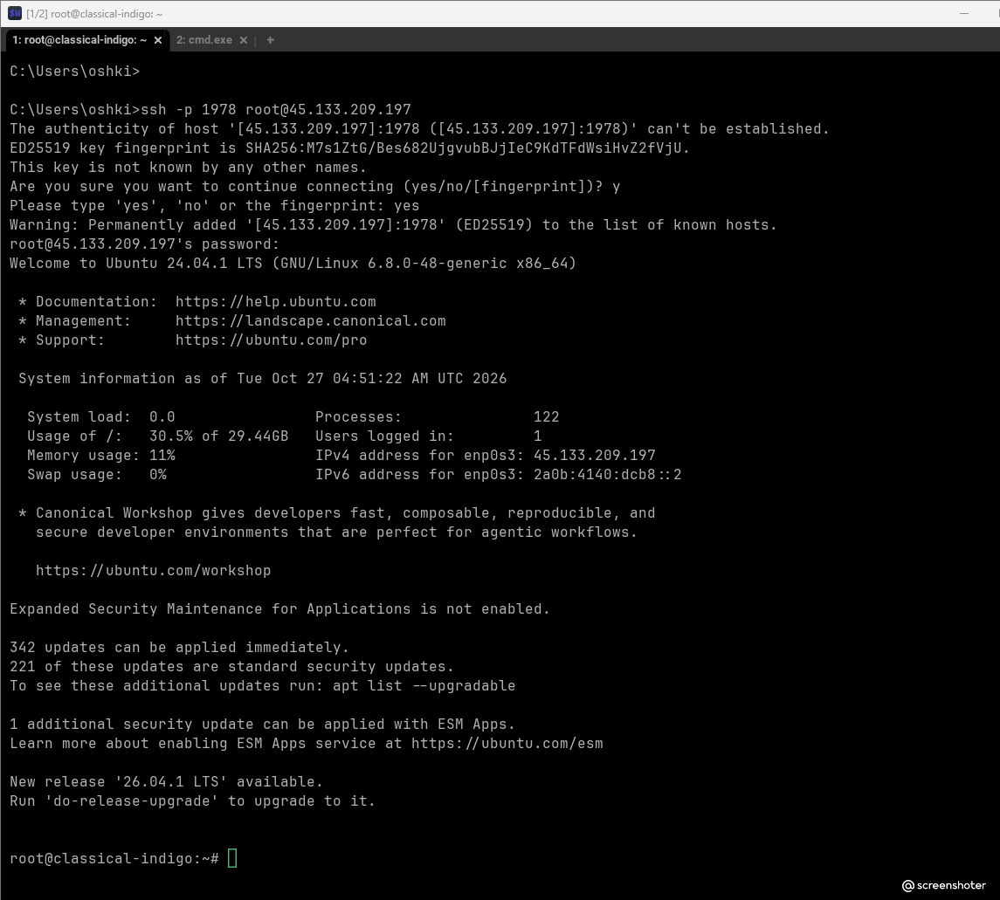

---

### 2. Подготовка тестовой базы данных и таблиц
На удаленном сервере осуществлен вход в консоль `psql` под пользователем `postgres` в базу данных `testdb`. Создана целевая таблица `orders` со служебным полем времени создания `created_at` и числовым полем `amount`.

```sql
CREATE TABLE orders (
    id SERIAL PRIMARY KEY,
    created_at TIMESTAMPTZ DEFAULT now(),
    amount NUMERIC
);
INSERT INTO orders (amount) VALUES (100.00), (200.00), (300.00);
```

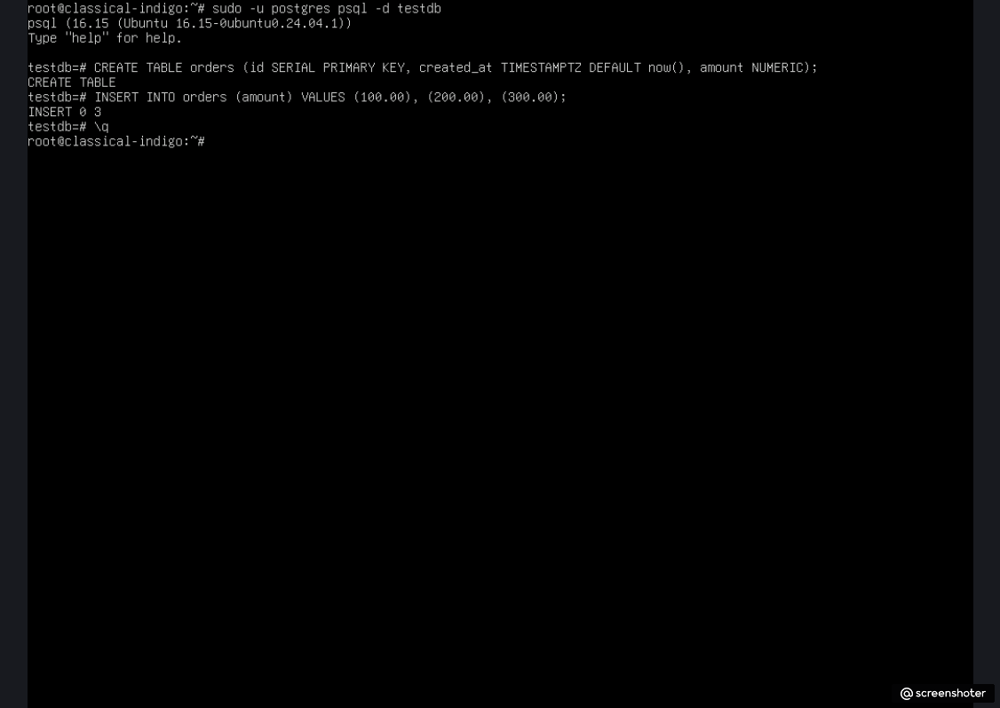

---

### 3. Тестирование уровня изоляции Read Committed (По умолчанию)

#### Шаг 3.1: Первичная фиксация данных в Сессии №2 (Читатель)
В Сессии №2 инициализирована транзакция. Выполнен агрегирующий запрос для подсчета количества заказов и их суммы.

```sql
BEGIN;
SELECT count(*), sum(amount) FROM orders;
```
*Результат:* `count = 3`, `sum = 600.00`.

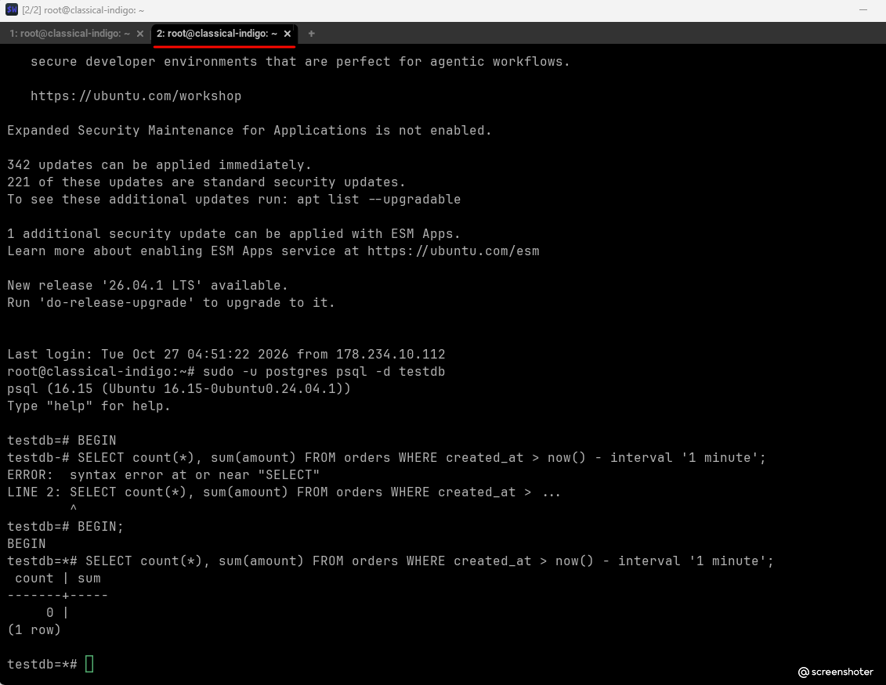

#### Шаг 3.2: Параллельная вставка в Сессии №1 (Писатель)
В это же время в Сессии №1 открывается параллельная транзакция, в которую добавляется новая запись с суммой `400.00`, после чего выполняется фиксирующий `COMMIT`.

```sql
BEGIN;
INSERT INTO orders (amount) VALUES (400.00);
COMMIT;
```

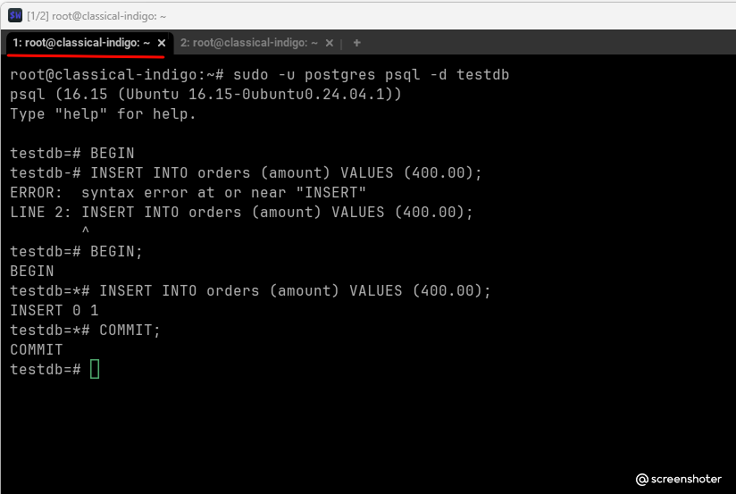

#### Шаг 3.3: Повторный запрос в Сессии №2 (Аномалия неповторяемого чтения)
Возвращаемся в Сессию №2, где первая транзакция всё еще остается **открытой**. Повторно выполняем тот же самый агрегатный запрос.

```sql
SELECT count(*), sum(amount) FROM orders;
```
*Результат:* `count = 4`, `sum = 1000.00`.

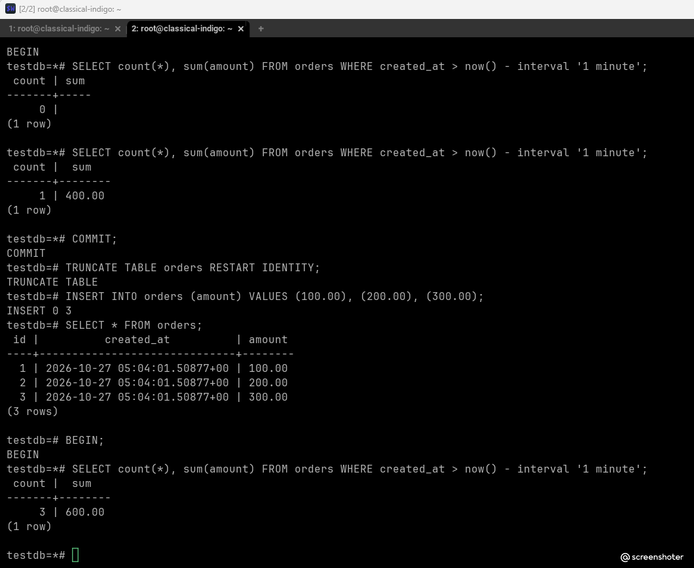

**Почему это произошло:** На стандартном для PostgreSQL уровне изоляции `Read Committed` каждый отдельный SQL-запрос внутри одной транзакции формирует свой собственный снимок данных (snapshot) на момент старта конкретно этого запроса. Поскольку Сессия №1 уже зафиксировала (`COMMIT`) свои изменения, Сессия №2 увидела их прямо посреди своей открытой транзакции. 

#### Шаг 3.4: Завершение транзакции Читателя
Сессия №2 закрывает транзакцию командой `COMMIT`.

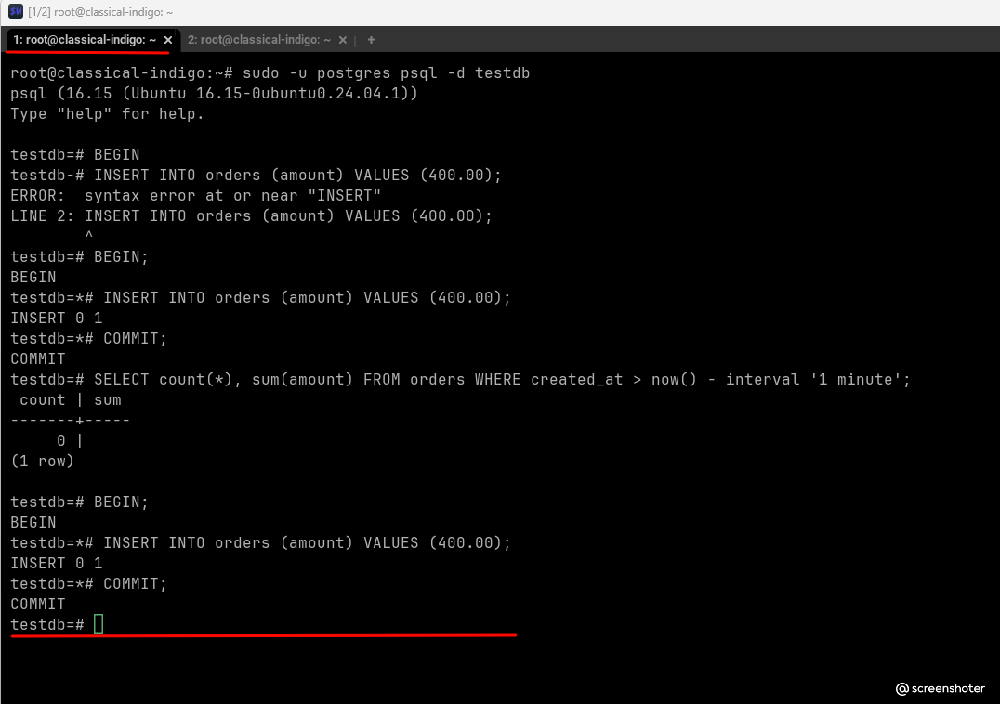

---

### 4. Тестирование уровня изоляции Repeatable Read

#### Шаг 4.1: Сброс данных к исходному состоянию
Для чистоты эксперимента из таблицы `orders` удалена запись со значением `400.00`, добавленная во время предыдущего теста. Таблица возвращена к базовым 3 строкам.

```sql
DELETE FROM orders WHERE amount = 400.00;
SELECT * FROM orders;
```

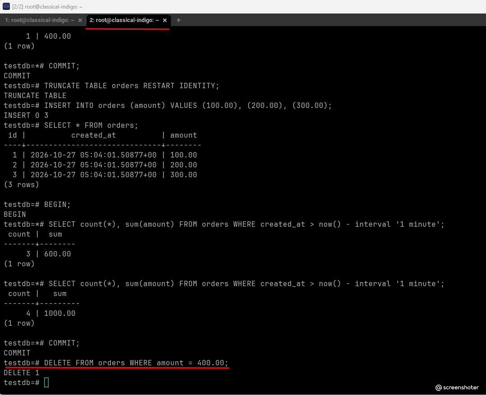

#### Шаг 4.2: Инициализация транзакций с уровнем Repeatable Read
В обеих сессиях параллельно запускаются транзакции с повышенным уровнем изоляции `REPEATABLE READ`.

*   **В Сессии №1 (Писатель)** открыта транзакция и установлен уровень изоляции:
    ```sql
    BEGIN;
    SET TRANSACTION ISOLATION LEVEL REPEATABLE READ;
    ```
    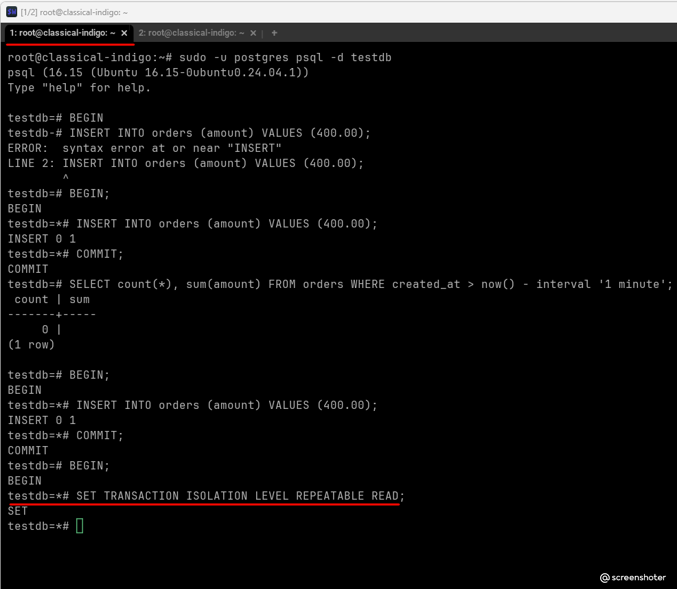

*   **В Сессии №2 (Читатель)** также открыта транзакция, установлен аналогичный уровень изоляции и выполнен первый срез данных:
    ```sql
    BEGIN;
    SET TRANSACTION ISOLATION LEVEL REPEATABLE READ;
    SELECT count(*), sum(amount) FROM orders;
    ```
    *Результат:* `count = 3`, `sum = 600.00`.

    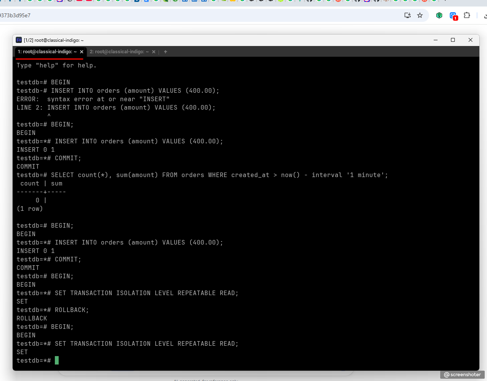

#### Шаг 4.3: Параллельная вставка в Сессии №1
В Сессии №1 (Писатель) производится добавление новой строки с суммой `500.00`, после чего транзакция фиксируется командой `COMMIT`.

```sql
INSERT INTO orders (amount) VALUES (500.00);
COMMIT;
```

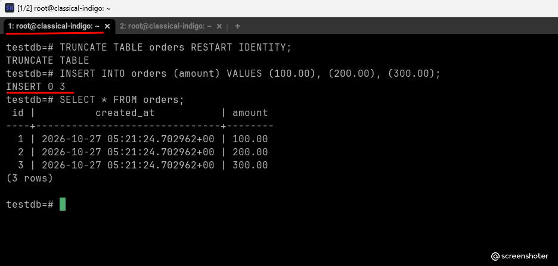

#### Шаг 4.4: Повторный запрос в Сессии №2 (Защита от неповторяемого чтения)
Возвращаемся в Сессию №2. Наша первая транзакция всё еще активна. Выполняем повторный агрегирующий запрос.

```sql
SELECT count(*), sum(amount) FROM orders;
```
*Результат:* `count = 3`, `sum = 600.00`.

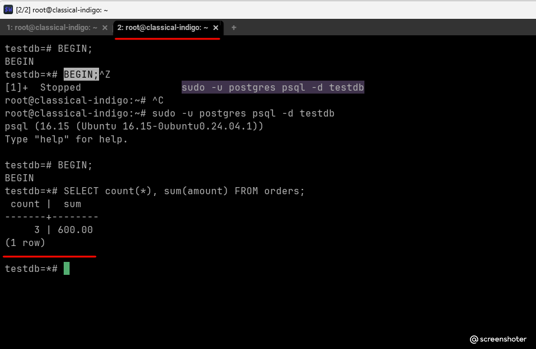

**Почему это произошло:** Уровень изоляции `Repeatable Read` в PostgreSQL использует технологию MVCC и фиксирует снимок базы данных (snapshot) строго **на момент выполнения первого запущенного запроса внутри транзакции**. Любые коммиты, сделанные другими параллельными сессиями после этой точки, текущая транзакция будет полностью игнорировать до тех пор, пока сама не завершится. Аномалия неповторяемого чтения успешно предотвращена.

#### Шаг 4.5: Фиксация транзакции в Сессии №2 и чтение обновленных данных
Завершаем транзакцию в Сессии №2 с помощью `COMMIT` и выполняем этот же запрос уже в контексте нового снимка данных.

```sql
COMMIT;
SELECT count(*), sum(amount) FROM orders;
```
*Результат:* `count = 4`, `sum = 1100.00`.

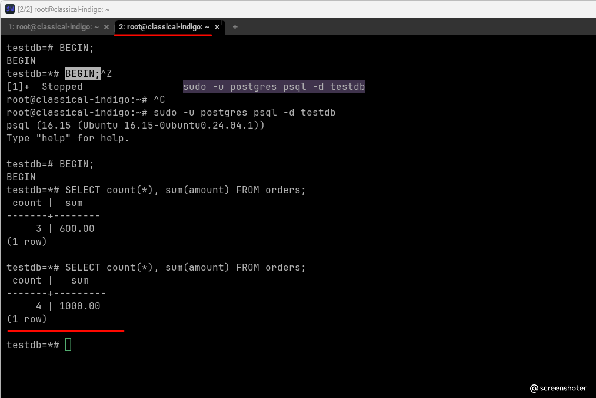

---

## Вывод: какой уровень изоляции необходим для построения отчётов

Для построения **согласованных финансовых или аналитических отчётов**, которые формируются на основе нескольких связанных или тяжелых агрегирующих запросов, стандартный уровень `Read Committed` **не подходит**. При параллельной записи данных цифры внутри одной сессии могут «прыгать» от запроса к запросу, приводя к рассинхронизации данных в итоговых таблицах отчёта (в нашем тесте сумма изменилась с 600.00 на 1000.00 прямо в процессе работы).

Для гарантированной консистентности отчёта **необходимо использовать уровень изоляции `Repeatable Read`**. 
1. Он фиксирует единый снимок данных (snapshot) на момент начала формирования отчёта (первого запроса).
2. Даже если параллельные процессы в этот момент будут массово добавлять, изменять или удалять строки в таблицах, наш отчёт сформируется на фиксированную «точку во времени».
3. Цифры гарантированно не изменятся до самого завершения транзакции, обеспечивая абсолютную бизнес-согласованность данных.
