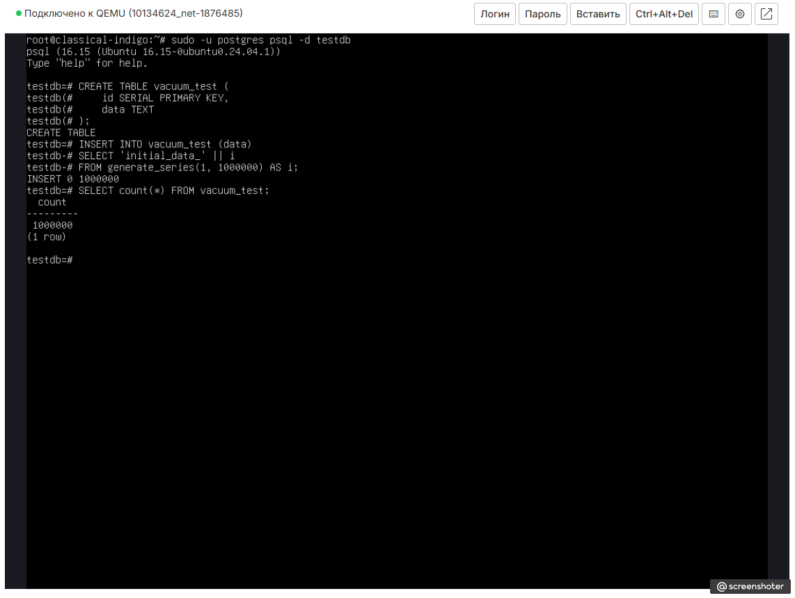
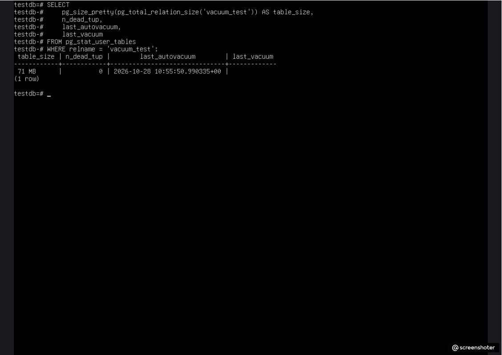
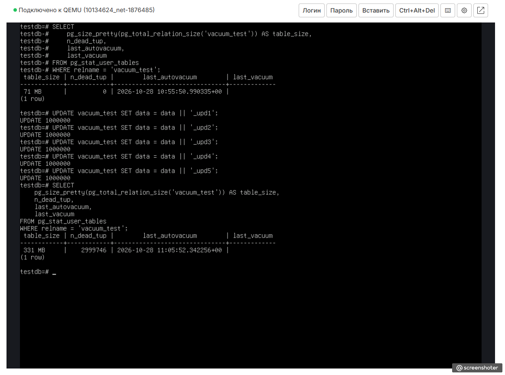
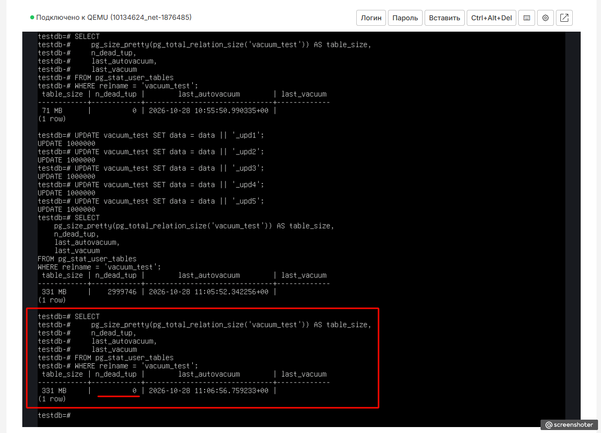
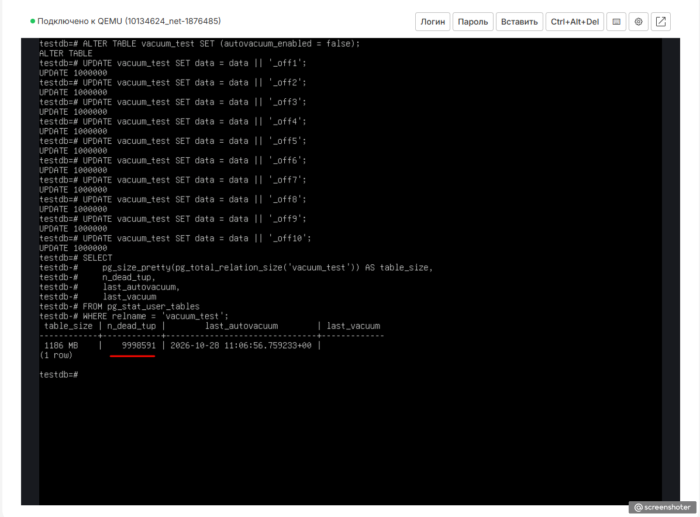
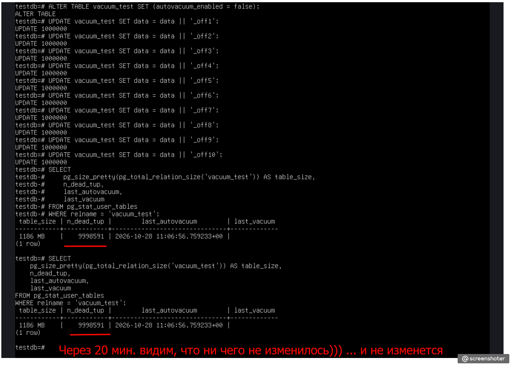
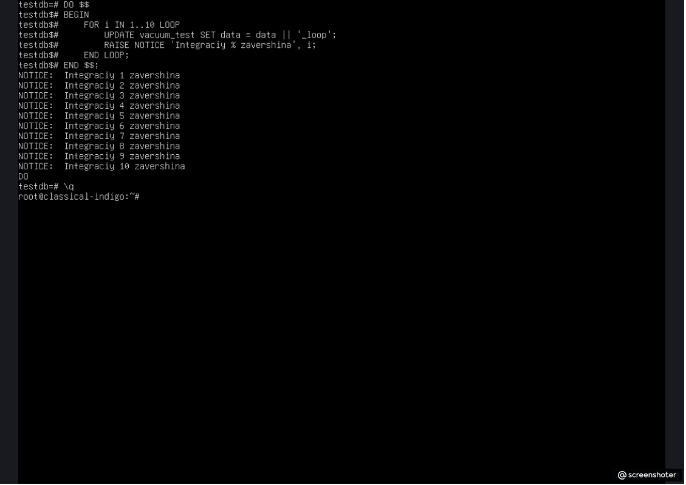

# Домашнее задание 6: Vacuum и autovacuum

## Цель
Диагностировать увеличение размера таблиц и управлять его состоянием с помощью vacuum и autovacuum.

## Ход выполнения

### 1. Подготовка таблицы
В базе данных `testdb` создана тестовая таблица `vacuum_test` с первичным ключом и текстовым полем `data`. С помощью функции `generate_series` таблица наполнена 1 000 000 уникальных строк со стартовыми значениями.

```sql
CREATE TABLE vacuum_test (
    id SERIAL PRIMARY KEY,
    data TEXT
);

INSERT INTO vacuum_test (data) 
SELECT 'initial_data_' || i FROM generate_series(1, 1000000) AS i;

SELECT count(*) FROM vacuum_test;
```



---

### 2. Исходное состояние
Выполнен первый замер физического размера таблицы (включая индексы) и сбор статистики по количеству мертвых строк (`n_dead_tup`) из системного представления `pg_stat_user_tables`.

```sql
SELECT 
    pg_size_pretty(pg_total_relation_size('vacuum_test')) AS table_size,
    n_dead_tup,
    last_autovacuum,
    last_vacuum
FROM pg_stat_user_tables
WHERE relname = 'vacuum_test';
```
*Результат:* Физический размер составляет **71 МБ**, количество мертвых строк — **0**. Процессы `vacuum` и `autovacuum` еще ни разу не запускались.



---

### 3. Состояние после 5 полных обновлений (UPDATE)
Для имитации интенсивной нагрузки на базу данных было запущено 5 последовательных полных обновлений поля `data` для абсолютно всех строк таблицы. Каждая итерация конкатенировала суффикс `_upd` к текущей строке.

```sql
UPDATE vacuum_test SET data = data || '_upd1';
UPDATE vacuum_test SET data = data || '_upd2';
UPDATE vacuum_test SET data = data || '_upd3';
UPDATE vacuum_test SET data = data || '_upd4';
UPDATE vacuum_test SET data = data || '_upd5';
```
Сразу по завершении обновлений выполнен замер параметров. Из-за архитектурных особенностей MVCC физический размер вырос до **331 МБ**, а счетчик `n_dead_tup` зафиксировал **2 999 746** скопившихся мертвых строк.



---

### 4. После срабатывания фонового autovacuum
Спустя непродолжительное время фоновый демон СУБД отреагировал на превышение установленного порога мертвых строк и автоматически произвел очистку таблицы.

Повторный запрос статистики показал, что поле `last_autovacuum` обновилось (зафиксировано время старта `11:06:56`), а количество мертвых строк (`n_dead_tup`) успешно сброшено до **0**. 

*Примечание:* Физический размер на диске при этом остался прежним — **331 МБ**, так как стандартный `vacuum` освобождает место внутри страниц для переиспользования последующими операциями `INSERT`/`UPDATE`, но не возвращает его операционной системе.



---

### 5. После отключения autovacuum и выполнения 10 обновлений
Для симуляции аварийной ситуации и демонстрации деградации хранения для таблицы `vacuum_test` был принудительно заблокирован автоматический вызов демона очистки. После этого выполнены 10 последовательных массовых апдейтов (от `_off1` до `_off10`).

```sql
ALTER TABLE vacuum_test SET (autovacuum_enabled = false);

UPDATE vacuum_test SET data = data || '_off1';
-- ... [выполнено 10 обновлений] ...
UPDATE vacuum_test SET data = data || '_off10';
```
*Результат:* База данных подверглась сильному эффекту «раздувания» (bloat). Количество мертвых строк подскочило до рекордных **9 998 591**, а физический размер на диске лавинообразно увеличился до **1186 МБ** (~1.18 ГБ).



При повторной проверке состояния этой же таблицы спустя 20 минут показатели остались абсолютно неизменными — без активного `autovacuum` СУБД не способна самостоятельно утилизировать неактуальные версии строк.



---

### Таблица наблюдений

| Этап эксперимента | Размер таблицы | n_dead_tup | last_autovacuum | Комментарий |
| :--- | ---: | ---: | :--- | :--- |
| **Исходное состояние** | 71 МБ | 0 | *(пусто)* | Таблица только что наполнена «чистыми» данными. |
| **После 5 обновлений** | 331 МБ | 2 999 746 | *(пусто)* | Накопление версий строк, резкий рост объема файлов. |
| **После autovacuum** | 331 МБ | 0 | 11:06:56 | Страницы очищены, место подготовлено под будущие записи. |
| **После отключения autovacuum + 10 UPDATE** | 1186 МБ | 9 998 591 | 11:06:56 *(не менялось)* | Критическое распухание (bloat) таблицы из-за запрета очистки. |

---

### 6. Объяснение физических процессов
В PostgreSQL при выполнении операции `UPDATE` физическая модификация существующей записи по ее старому адресу не происходит. Вместо этого старая версия строки (tuple) маркируется служебными флагами как «мертвая», а обновленные данные записываются на свободное место как абсолютно новая строка. Это фундаментальный принцип MVCC (многоверсионности), исключающий блокировки между читающими и пишущими транзакциями.

*   **При включенном autovacuum:** Система периодически анализирует процент изменений. Обнаружив мертвые строки, демон вычищает ссылки на них, делая пространство внутри файлов доступным для записи новых данных. Таблица стабилизируется в объемах.
*   **При отключенном autovacuum:** Место, занятое мертвыми строками, блокируется. Любой новый `UPDATE` вынужден запрашивать у ОС новые дисковые блоки, бесконечно растягивая файл таблицы. Это приводит к деградации производительности дисковой подсистемы и неэффективному расходу памяти.

---

### ⭐️ Задание со звёздочкой (Анонимный блок DO)

После завершения тестов функция `autovacuum` для таблицы была возвращена в штатный режим работы (`SET (autovacuum_enabled = true)`). В качестве демонстрации автоматизации процессов был написан и успешно выполнен анонимный PL/pgSQL блок, осуществляющий 10 обновлений таблицы `vacuum_test` в рамках единого цикла с логированием этапов через `RAISE NOTICE`:

```sql
DO \[ BEGIN FOR i IN 1..10 LOOP UPDATE vacuum_test SET data = data \vert{}\vert{} '_loop'; RAISE NOTICE 'Integraciy \% zavershina', i; END LOOP; END \];
```



**Итог:** Задание выполнено в полном объёме. По завершении работы весь кластер баз данных возвращен в стабильное и безопасное состояние.
