# Домашнее задание 8: Механизм блокировок

## Цель
Диагностировать блокировки и взаимоблокировки по журналу сообщений СУБД и системному представлению `pg_locks`.

## Ход выполнения

### 1. Настройка логирования ожиданий блокировок
Для детального анализа проблем конкурентного доступа в конфигурации кластера были активированы параметры отслеживания долгих ожиданий. Время таймаута автоматического обнаружения взаимоблокировок (deadlocks) сокращено до 200 миллисекунд. Изменения применены без перезапуска сервера.

```sql
ALTER SYSTEM SET log_lock_waits = on;
ALTER SYSTEM SET deadlock_timeout = '200ms';
SELECT pg_reload_conf();

SHOW log_lock_waits;
SHOW deadlock_timeout;
```

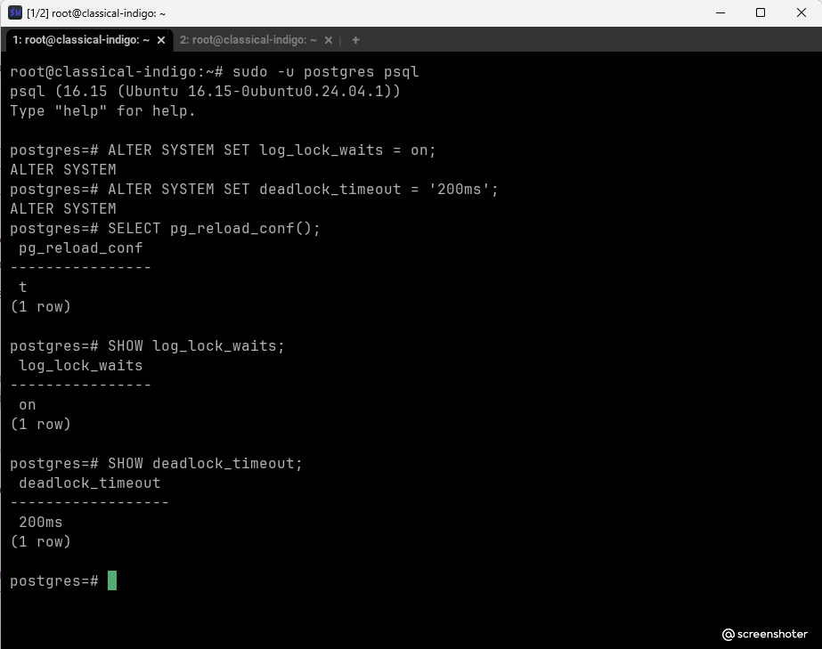

---

### 2. Создание тестовой таблицы
В базе данных создана изолированная таблица `lock_test` с одной строкой для симуляции жесткой конкуренции между параллельными сессиями.

```sql
CREATE TABLE lock_test (id INT PRIMARY KEY, value TEXT);
INSERT INTO lock_test VALUES (1, 'initial');
SELECT * FROM lock_test;
```

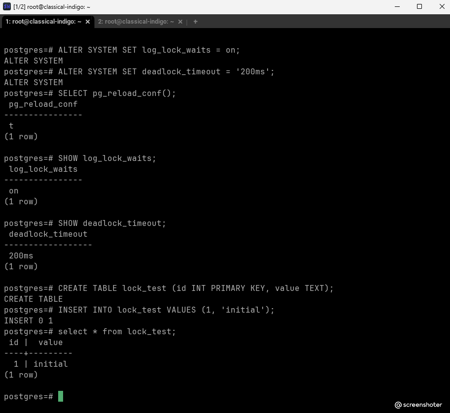

---

### 3. Воспроизведение ожидания блокировки (3 сессии)
Для демонстрации очереди ожиданий были открыты три параллельные сессии терминала. Каждая из них открывает транзакцию и пытается обновить одну и ту же строку с `id = 1`.

*   **Сессия №1 (PID 216133):** Первой захватывает строку и успешно выполняет инструкцию, оставляя транзакцию открытой.
    ```sql
    BEGIN;
    UPDATE lock_test SET value = 'from_session_1' WHERE id = 1;
    ```
    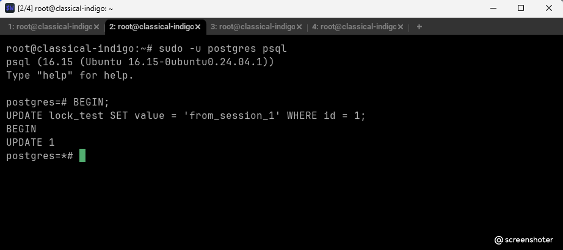

*   **Сессия №2 (PID 216309):** Пытается выполнить аналогичный `UPDATE` и уходит в ожидание освобождения ресурса.
    ```sql
    BEGIN;
    UPDATE lock_test SET value = 'from_session_2' WHERE id = 1;
    ```
    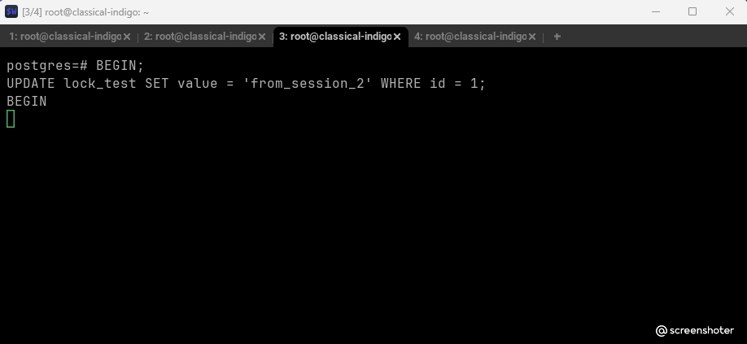

*   **Сессия №3 (PID 216315):** Встает в очередь вслед за Сессией №2.
    ```sql
    BEGIN;
    UPDATE lock_test SET value = 'from_session_3' WHERE id = 1;
    ```
    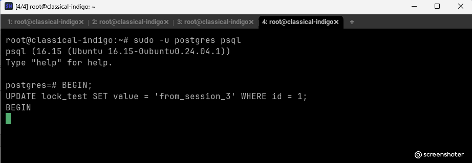

---

### 4. Анализ блокировок через pg_locks
В отдельном служебном окне был выполнен аналитический запрос к метаданным СУБД для выявления структуры взаимных блокировок и очередей:

```sql
SELECT
    pid,
    locktype,
    relation::regclass AS relation,
    mode,
    granted,
    pg_blocking_pids(pid) AS blocked_by
FROM pg_locks
WHERE relation = 'lock_test'::regclass
ORDER BY pid;
```

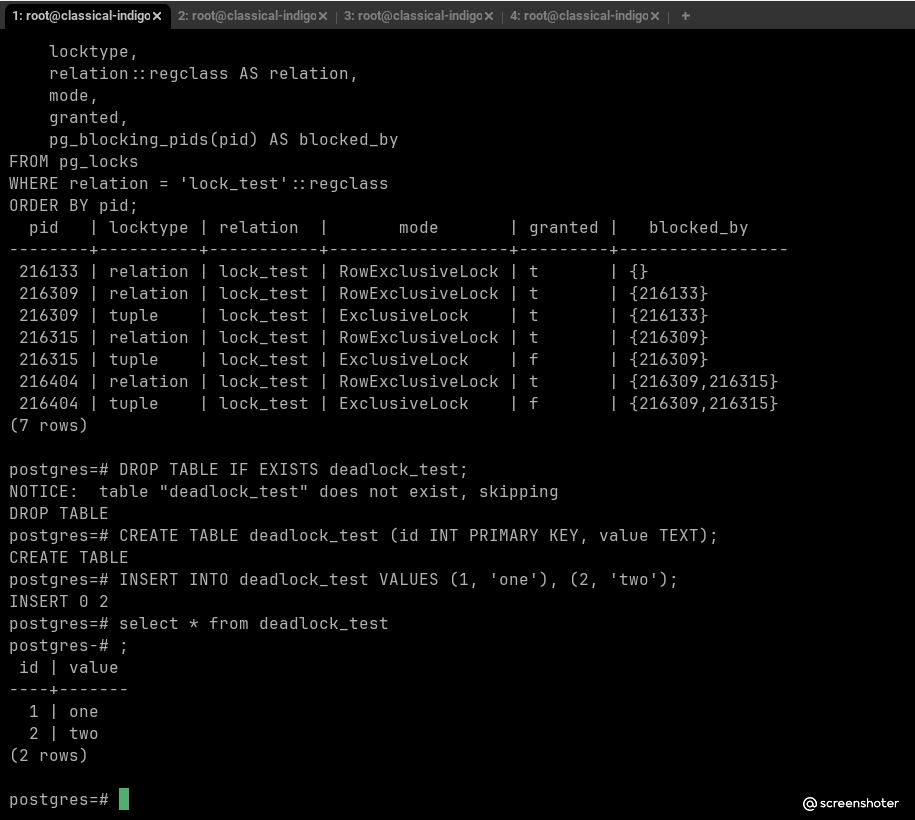

#### Детальное объяснение структуры распределения блокировок:

| pid | locktype | relation | mode | granted | blocked_by | Пояснение |
| :--- | :--- | :--- | :--- | :---: | :--- | :--- |
| **216133** | relation | lock_test | RowExclusiveLock | t | {} | **Сессия 1**. Успешно удерживает блокировку таблицы на изменение структуры данных. |
| **216309** | relation | lock_test | RowExclusiveLock | t | {216133} | **Сессия 2**. Получила блокировку таблицы, но заблокирована Сессией 1 на уровне строки. |
| **216309** | tuple | lock_test | ExclusiveLock | t | {216133} | **Сессия 2**. Успешно захватила блокировку версии физической строки (tuple), но ждет коммита Сессии 1. |
| **216315** | relation | lock_test | RowExclusiveLock | t | {216309} | **Сессия 3**. Захватила блокировку таблицы, но ожидает транзакцию Сессии 2. |
| **216315** | tuple | lock_test | ExclusiveLock | f | {216309} | **Сессия 3**. Статус `granted = f` (Ложь). Процесс заблокирован на попытке получить доступ к версии строки. |
| **216404** | relation | lock_test | RowExclusiveLock | t | {216309,216315} | **Сессия 4**. Захватила блокировку таблицы, ожидает освобождения ресурсов предыдущими сессиями. |
| **216404** | tuple | lock_test | ExclusiveLock | f | {216309,216315} | **Сессия 4**. Статус `granted = f`. Заблокирована в хвосте очереди ожидания. |

---

### 5. Воспроизведение взаимоблокировки (Deadlock) через UPDATE
Для демонстрации базового дедлока создана таблица `deadlock_test` с двумя записями.

```sql
DROP TABLE IF EXISTS deadlock_test;
CREATE TABLE deadlock_test (id INT PRIMARY KEY, value TEXT);
INSERT INTO deadlock_test VALUES (1, 'one'), (2, 'two');
```
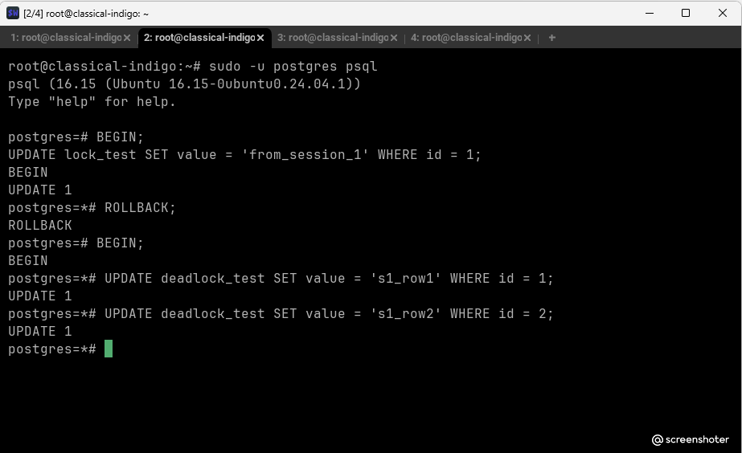

Две транзакции параллельно обновляют строки в противоположном порядке:
1. Сессия 1 обновляет `id = 1`, затем запрашивает `id = 2`.
2. Сессия 2 обновляет `id = 2`, затем запрашивает `id = 1`.

В результате Сессия 2 мгновенно получает отказ от СУБД с прерыванием операции:

```text
ERROR: deadlock detected
DETAIL: Process 216309 waits for ShareLock on transaction 2529324; blocked by process 216133.
Process 216133 waits for ShareLock on transaction 2529325; blocked by process 216309.
```
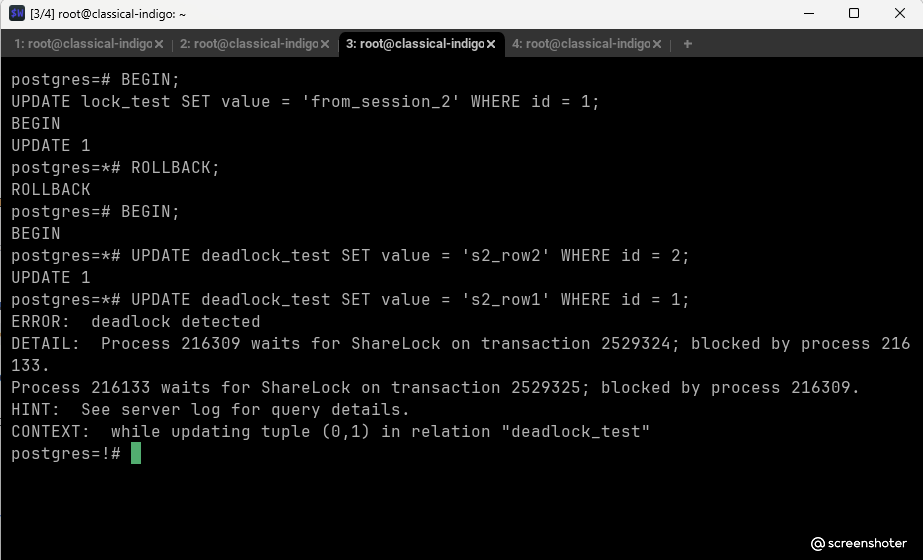

#### Анализ инцидента по системному журналу (PostgreSQL Log)
В лог-файле подробнейшим образом зафиксирована вся цепочка событий с указанием PID участников, номеров конфликтующих транзакций, названий таблиц и физических адресов заблокированных строк.

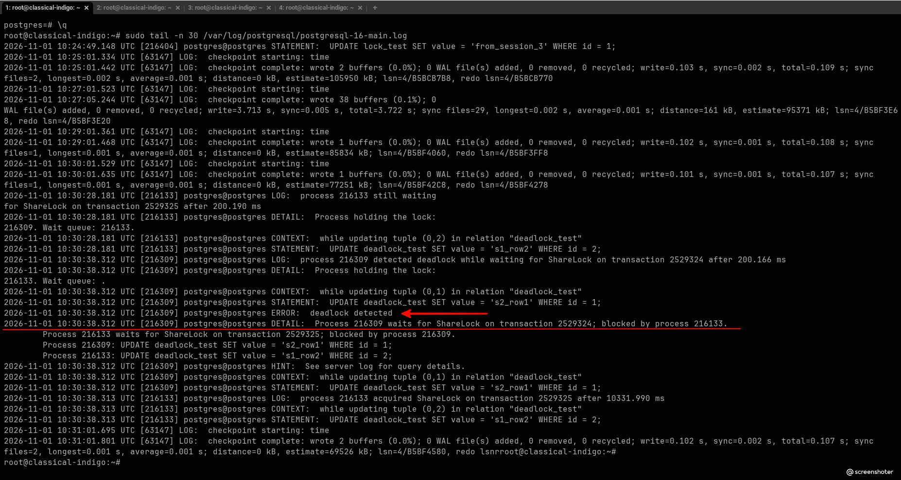

**Ответ на вопрос задания:** Можно ли разобраться в случившемся постфактум? **Да, абсолютно.** Системный журнал PostgreSQL при включенном `log_lock_waits` предоставляет исчерпывающие сведения для разбора инцидентов.

---

<!--
### 6. Задание со звёздочкой: Взаимоблокировка при явном блокировании строк через SELECT FOR UPDATE

В качестве расширенного эксперимента был воспроизведен сценарий взаимоблокировки, использующий явное блокирование строк `SELECT ... FOR UPDATE` (пессимистическое блокирование) в комбинации с последующими командами `UPDATE`.

#### Шаг 6.1: Действия в Сессии №2
Сессия №2 инициирует транзакцию, накладывает эксклюзивную блокировку на строку с `id = 1`, а затем запрашивает модификацию строки `id = 2`.
```sql
BEGIN;
SELECT * FROM deadlock_test WHERE id = 1 FOR UPDATE;
UPDATE deadlock_test SET value = 'test' WHERE id = 2;
```
Транзакция успешно захватывает первую строку и выполняет обновление второй.

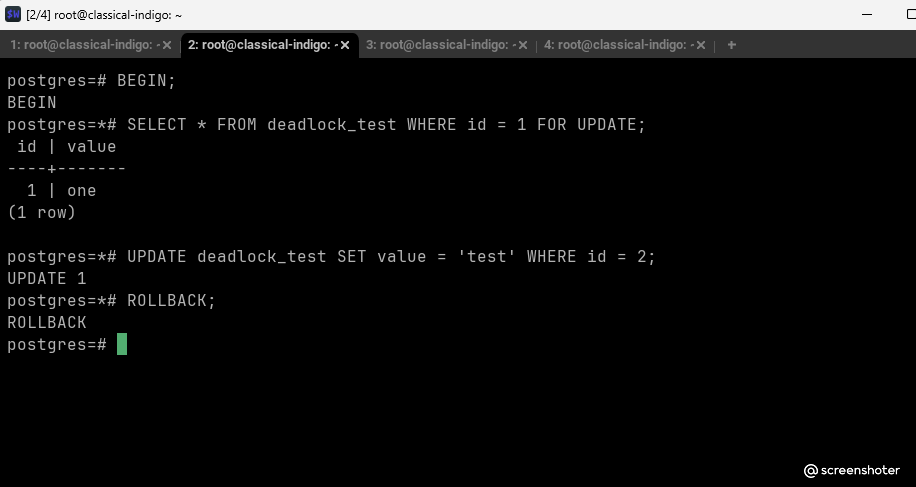

#### Шаг 6.2: Перекрёстный запрос в Сессии №3 и дедлок
Параллельно в Сессии №3 запускается транзакция, которая идет по зеркальному сценарию: блокирует через `FOR UPDATE` строку `id = 2` и запрашивает `UPDATE` строки `id = 1`.
```sql
BEGIN;
SELECT * FROM deadlock_test WHERE id = 2 FOR UPDATE;
UPDATE deadlock_test SET value = 'test' WHERE id = 1;
```
В этот момент СУБД моментально фиксирует циклическое ожидание (Сессия 2 держит `id=1` и ждет высвобождения `id=2`, а Сессия 3 удерживает `id=2` и пытается писать в `id=1`). Происходит автоматический обрыв транзакции в Сессии №3.

```text
ERROR: deadlock detected
DETAIL: Process 216309 waits for ShareLock on transaction 2529326; blocked by process 216133.
Process 216133 waits for ShareLock on transaction 2529327; blocked by process 216309.
CONTEXT: while updating tuple (0,1) in relation "deadlock_test"
```

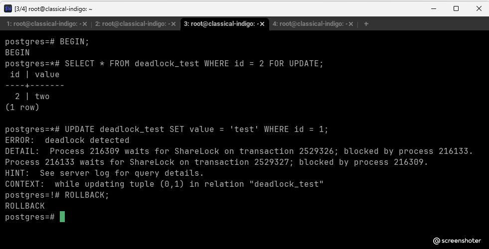

#### Шаг 6.3: Анализ системного журнала для сценария со звёздочкой
По логу сервера `/var/log/postgresql/postgresql-16-main.log` была полностью восстановлена хронологическая последовательность инцидента.

```text
2026-11-01 10:43:23.775 UTC [216133] LOG: process 216133 still waiting for ShareLock on transaction 2529327 after 200.164 ms
2026-11-01 10:43:33.972 UTC [216309] LOG: process 216309 detected deadlock while waiting for ShareLock on transaction 2529326 after 200.205 ms
2026-11-01 10:43:33.972 UTC [216309] ERROR: deadlock detected
```

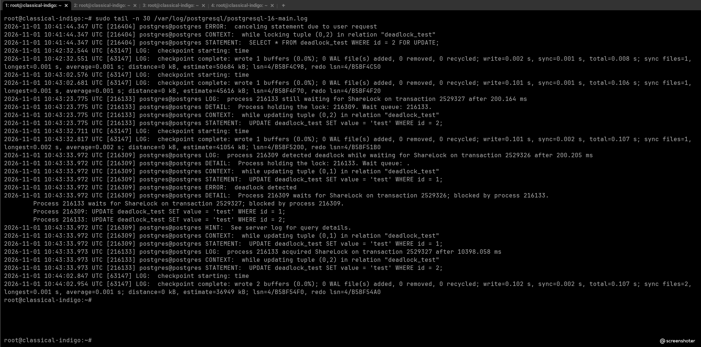

**Вывод:** Использование конструкций явного пессимистического блокирования строк (`FOR UPDATE`) требует строгого соблюдения порядка обхода бизнес-сущностей на уровне кода приложения. Нарушение порядка вызова (например, обработка записей в разной последовательности в разных методах бэкенда) гарантированно ведет к деградации производительности СУБД и регулярным аварийным отменам транзакций из-за дедлоков.
-->

### 6. Ответ на вопрос: UPDATE без WHERE (задание со звёздочкой)
**Могут ли две транзакции, выполняющие единственную команду UPDATE одной и той же таблицы (без where), заблокировать друг друга?**

**Теоретически — да, но на практике это сложно воспроизвести «в лоб».** 

Если две транзакции выполняют `UPDATE table SET ...` (без `WHERE`), PostgreSQL обрабатывает строки в порядке их физического расположения (по `ctid`). Поскольку порядок одинаковый, транзакции просто выстраиваются в очередь: первая блокирует строку, вторая ждёт. Дедлока не возникает.

Однако дедлок **возможен**, если порядок обработки строк различается. Это может произойти, например, если:
- Планы выполнения запросов отличаются (из-за разных индексов или статистики).
- Таблица была изменена между транзакциями (например, вставлены новые строки, изменившие физическое расположение).

**Попытка воспроизведения:**
Мы попытались воспроизвести ситуацию с `UPDATE` без `WHERE` в двух сессиях. В нашем случае дедлок не возник (транзакции выстроились в очередь). Это подтверждает, что при одинаковом порядке обработки строк дедлок не возникает.


**Вывод:** Две транзакции с `UPDATE` без `WHERE` могут заблокировать друг друга только при наличии условий, приводящих к разному порядку обработки строк. В обычной ситуации они просто выстраиваются в очередь.