# Домашнее задание 9: Работа с JOIN

## Цель
Знать и уметь применять различные виды JOIN'ов; строить и анализировать план выполнения запроса; оптимизировать запрос; уметь собирать и анализировать статистику для таблицы.

## Структура таблиц
В рамках лабораторной работы в базе данных `testdb` были созданы три связанные таблицы для сущностей автопарка:
- `buses` (bus_id, name) — автобусы
- `drivers` (driver_id, first_name, second_name) — водители
- `routes` (route_id, name, bus_id, driver_id) — маршруты

```sql
CREATE TABLE buses (
    bus_id serial PRIMARY KEY,
    name varchar
);

CREATE TABLE drivers (
    driver_id serial PRIMARY KEY,
    first_name varchar,
    second_name varchar
);

CREATE TABLE routes (
    route_id serial PRIMARY KEY,
    name varchar,
    bus_id int,
    driver_id int
);
```

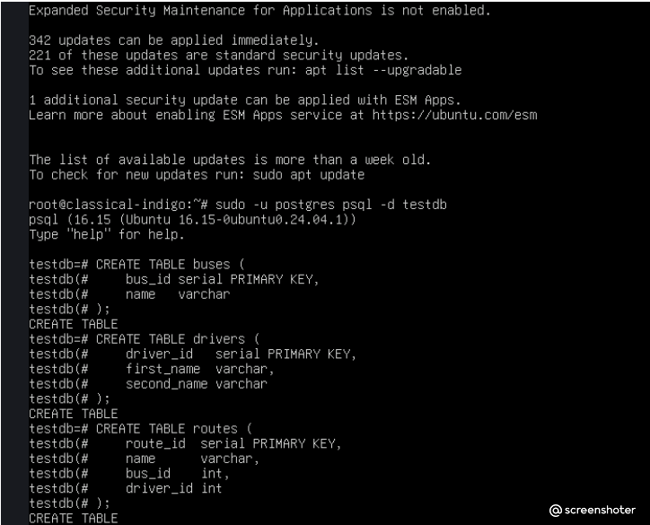

Таблицы были наполнены тестовыми наборами данных, включающими пограничные случаи: маршруты без назначенных автобусов/водителей (`NULL`), а также автобусы, не привязанные ни к одному рейсу.

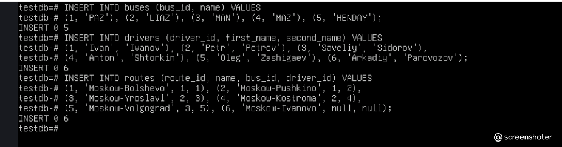

---

## Ход выполнения и типы соединений

### 1. Прямое соединение (INNER JOIN)
```sql
SELECT r.name AS route, b.name AS bus, d.first_name || ' ' || d.second_name AS driver
FROM routes r
JOIN buses b ON r.bus_id = b.bus_id
JOIN drivers d ON r.driver_id = d.driver_id;
```
*Комментарий:* Возвращает строго пересечение множеств — только те маршруты, у которых одновременно есть и назначенный автобус, и закрепленный водитель. Из 6 маршрутов в выборку попали 5.

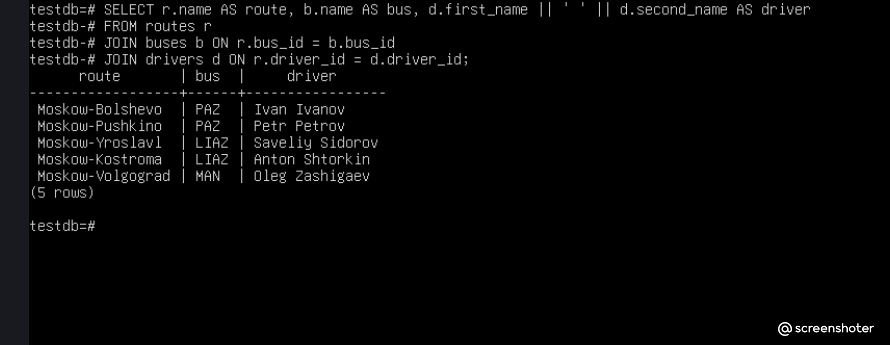

---

### 2. Левостороннее соединение (LEFT JOIN)
```sql
SELECT r.name AS route, b.name AS bus
FROM routes r
LEFT JOIN buses b ON r.bus_id = b.bus_id;
```
*Комментарий:* Возвращает абсолютно все строки из левой таблицы (`routes`), даже если для них нет соответствия в правой. Для маршрута «Moskow-Ivanovo» автобус не назначен, поэтому в поле `bus` вывелся `NULL`.

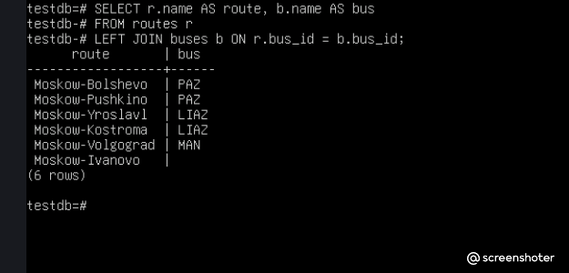

---

### 3. Правостороннее соединение (RIGHT JOIN)
```sql
SELECT r.name AS route, b.name AS bus
FROM routes r
RIGHT JOIN buses b ON r.bus_id = b.bus_id;
```
*Комментарий:* Сохраняет все строки из правой таблицы (`buses`), даже если они не используются в маршрутах. В результирующей выборке появились автобусы «HENDAY» и «MAZ» со значением `NULL` в колонке маршрута.

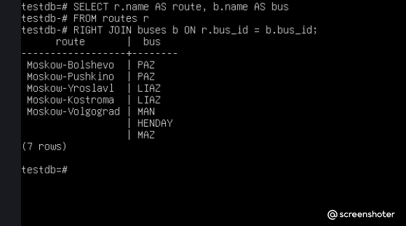

---

### 4. Кросс-соединение (CROSS JOIN)
```sql
SELECT r.name AS route, b.name AS bus
FROM routes r
CROSS JOIN buses b;
```
*Комментарий:* Формирует декартово произведение множеств (каждая строка первой таблицы соединяется с каждой строкой второй таблицы). Итоговый объем выборки составил: 6 маршрутов × 5 автобусов = 30 строк.

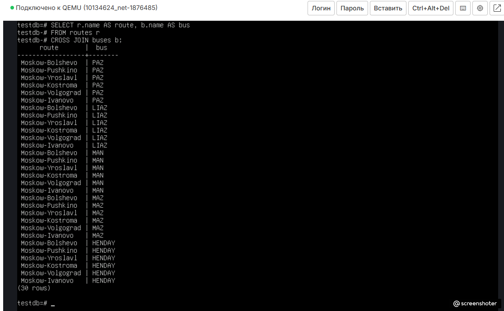

---

### 5. Полное соединение (FULL JOIN)
```sql
SELECT r.name AS route, b.name AS bus
FROM routes r
FULL JOIN buses b ON r.bus_id = b.bus_id;
```
*Комментарий:* Объединяет поведение `LEFT JOIN` и `RIGHT JOIN`. Выводит все маршруты (включая не обеспеченные транспортом) и все автобусы (включая простаивающие без маршрута). Итого: 8 строк.

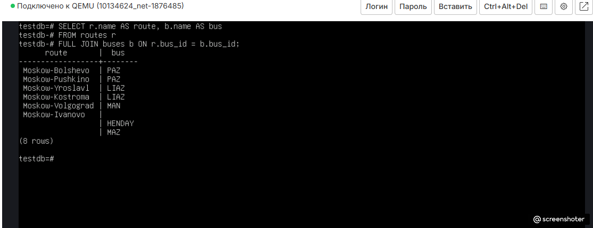

---

### 6. Комбинация различных типов соединений (Other/Mixed JOIN)
```sql
SELECT r.name AS route, b.name AS bus, d.first_name || ' ' || d.second_name AS driver
FROM routes r
LEFT JOIN buses b ON r.bus_id = b.bus_id
JOIN drivers d ON r.driver_id = d.driver_id;
```
*Комментарий:* Демонстрация комбинированной выборки. За счет использования `LEFT JOIN` для автобусов сохраняются маршруты без машин, однако последующий `JOIN` (INNER) по водителям отсекает строки, где `driver_id IS NULL`. В итоге вернулось 5 строк.

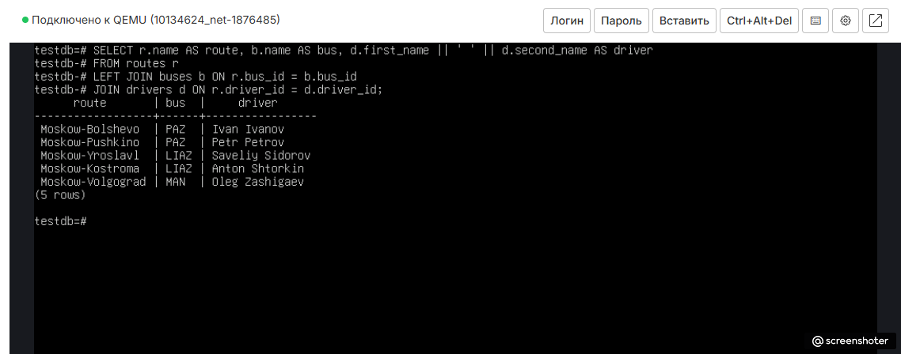

---

## Анализ плана запроса

### 1. План выполнения по умолчанию (Hash Join)
Для анализа базового поведения планировщика был выполнен запрос `EXPLAIN (ANALYZE, BUFFERS)` при стандартных настройках оптимизатора.

```sql
SET join_collapse_limit = 1;
EXPLAIN (ANALYZE, BUFFERS)
SELECT * FROM routes r
JOIN buses b ON r.bus_id = b.bus_id
JOIN drivers d ON r.driver_id = d.driver_id;
```

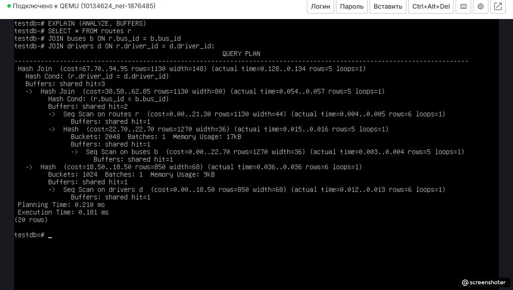

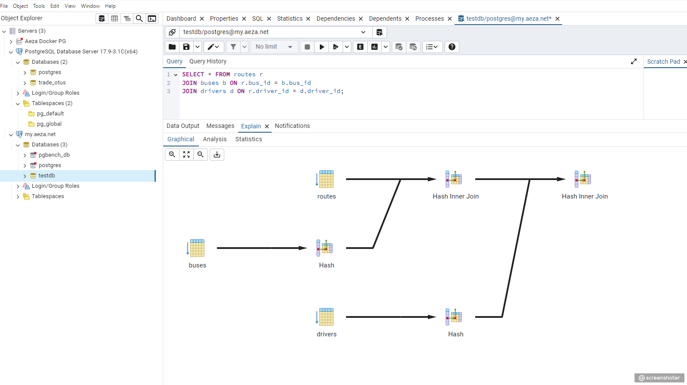

*Анализ плана:*
Планировщик СУБД выбрал алгоритм **Hash Inner Join**. Поскольку участвующие в запросе таблицы имеют небольшой объем, это наиболее эффективный выбор. PostgreSQL сначала выполнил последовательное сканирование (`Seq Scan`) таблицы `buses` и построил по ней хеш-таблицу в оперативной памяти (`Hash`, объем памяти 17 КБ). Затем он просканировал `routes`, сопоставив строки по условию `r.bus_id = b.bus_id`. На втором этапе аналогичным образом была построена хеш-таблица для `drivers` (объем памяти 9 КБ) для финального соединения. Реальное время выполнения всего запроса составило рекордные **0.083 мс**.

---

### 2. План с принудительным отключением хеширования (Nested Loop)
Для симуляции альтернативного поведения оптимизатора и оценки нелинейных планов соединений, использование алгоритмов `Hash Join` и `Merge Join` было принудительно запрещено на уровне сессии.

```sql
SET enable_hashjoin = off;
SET enable_mergejoin = off;
SET join_collapse_limit = 1;

EXPLAIN (ANALYZE, BUFFERS)
SELECT * FROM routes r
JOIN buses b ON r.bus_id = b.bus_id
JOIN drivers d ON r.driver_id = d.driver_id;
```

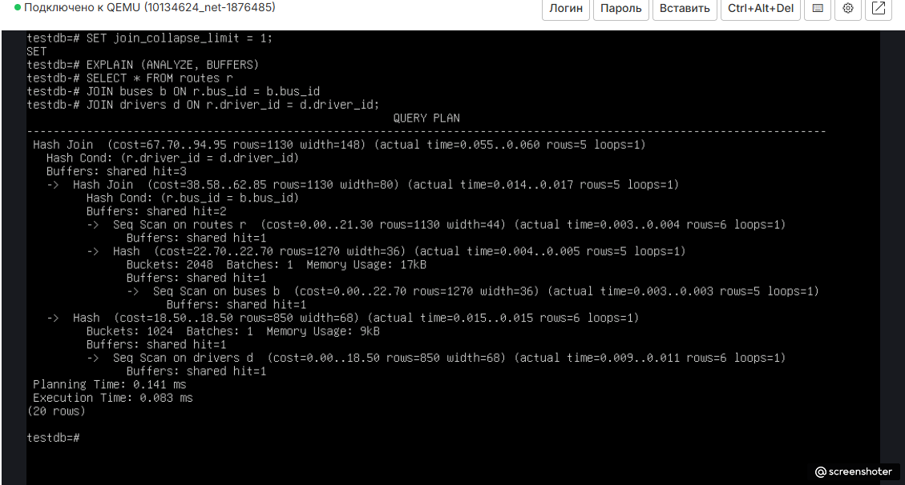

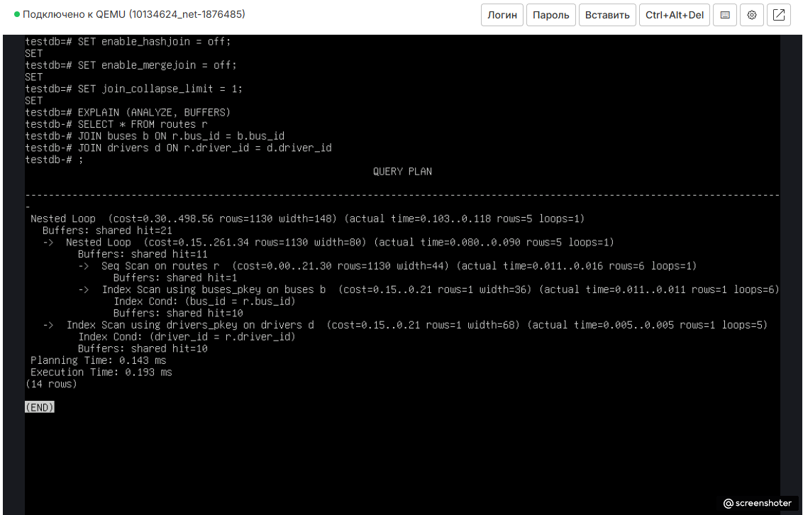

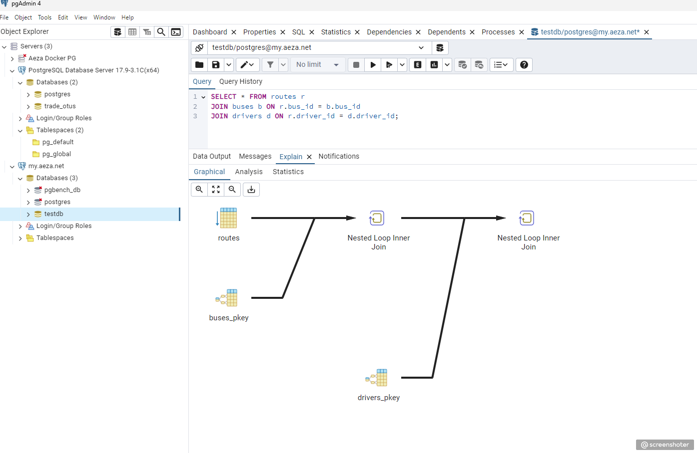

*Анализ плана:*
Лишившись возможности строить хеш-таблицы, оптимизатор был вынужден переключиться на алгоритм **Nested Loop Inner Join** (вложенные циклы). Механизм работает следующим образом: СУБД делает последовательное сканирование ведущей таблицы `routes` (`Seq Scan`), и для *каждой* найденной строки выполняет точечный поиск во внутренних таблицах `buses` и `drivers`. 

Поскольку поиск во вложенных циклах происходит по первичным ключам, планировщик задействовал индексы `buses_pkey` и `drivers_pkey` (`Index Scan`). На малых объемах данных это отработало быстро, но общее время выполнения все равно увеличилось более чем в два раза — до **0.193 мс**, а количество обращений к буферам памяти (`Buffers: shared hit`) выросло с **3** до **21**. На больших таблицах без индексов такой план привел бы к критическому падению производительности.

---

## Сбор статистики (ANALYZE)
Для поддержания актуальности метаданных СУБД, на основе которых планировщик строит свои отчеты и выбирает стоимости (`cost`), была произведена ручная калибровка статистики для всех трех таблиц с последующей проверкой системного представления `pg_stat_user_tables`.

```sql
ANALYZE routes;
ANALYZE buses;
ANALYZE drivers;

SELECT relname, n_live_tup, n_dead_tup, last_analyze
FROM pg_stat_user_tables
WHERE relname IN ('routes', 'buses', 'drivers');
```

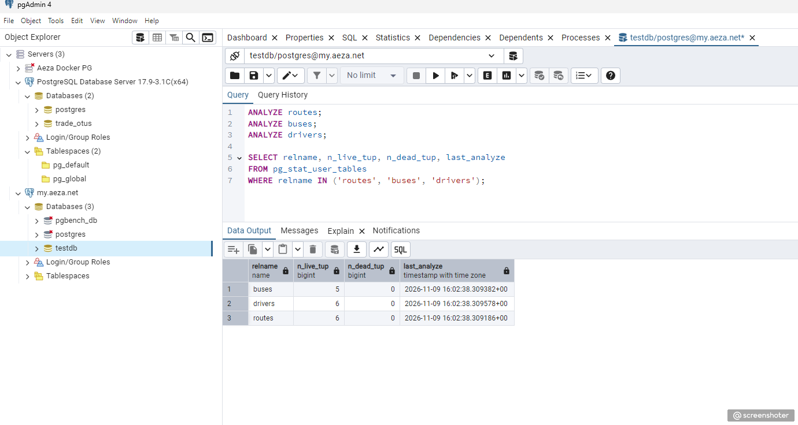

*Вывод:* После выполнения команд `ANALYZE` системные счетчики СУБД синхронизировались с физическим состоянием дисковых страниц. Поля `n_live_tup` четко отражают реальное количество живых записей в таблицах (5 для автобусов, 6 для водителей и маршрутов), а столбец `last_analyze` зафиксировал точное время ручного сбора статистики.

---

## Общий вывод
1. **Виды JOIN:** Каждый тип соединения служит для строго определенных бизнес-требований: `INNER JOIN` незаменим для получения строгих пересечений, `LEFT`/`RIGHT JOIN` гарантируют сохранение строк одной из сторон при отсутствии связей, `FULL JOIN` собирает полную картину сущностей, а `CROSS JOIN` используется для генерации матриц или декартовых сеток.
2. **Планы выполнения:** Анализ планов в pgAdmin и консоли наглядно показывает внутреннюю логику работы оптимизатора. Наглядно доказано, что для небольших несвязанных наборов данных СУБД предпочитает `Hash Join`, минимизирующий чтение страниц.
3. **Роль статистики:** Своевременный сбор статистики через `ANALYZE` является критически важным условием стабильности реляционной базы данных. Без актуальных данных о распределении строк оптимизатор может выбрать заведомо неэффективный план (например, тяжелый `Nested Loop` вместо быстрого `Hash Join`), что приведет к деградации всей информационной системы.
