# Домашнее задание: Работа с индексами

## Цель
Знать и уметь применять основные виды индексов PostgreSQL; строить и анализировать план выполнения запроса; оптимизировать запросы для использования индексов.

## Ход выполнения

```bash
wget https://edu.postgrespro.ru/demo-20250901-6m.sql.gz
gunzip demo-20250901-6m.sql.gz
sudo -u postgres psql -f demo-20250901-6m.sql
sudo cp demo-20250901-6m.sql /tmp/
sudo -u postgres psql -f /tmp/demo-20250901-6m.sql
sudo -u postgres psql -d demo -c "SELECT count(*) FROM tickets;"
sudo -u postgres psql -d demo
```

---

### 1. Обычный B-tree индекс на `passenger_name`

#### Состояние до создания индекса
Выполнен тестовый запрос на поиск билетов по точному совпадению имени пассажира в таблице `tickets` (5 598 473 записи).

```sql
EXPLAIN (ANALYZE, BUFFERS)
SELECT * FROM tickets WHERE passenger_name = 'EVGENIY MAKAROV';
```

**План выполнения (до индекса):**
```text
Gather (cost=1000.00..87977.62 rows=37 width=52) (actual time=2933.415..2955.624 rows=0 loops=1)
  Workers Planned: 2
  Workers Launched: 2
  Buffers: shared hit=192 read=57624
  -> Parallel Seq Scan on tickets (cost=0.00..86973.92 rows=15 width=52) (actual time=2925.697..2925.698 rows=0 loops=3)
        Filter: (passenger_name = 'EVGENIY MAKAROV'::text)
        Rows Removed by Filter: 1866158
        Buffers: shared hit=192 read=57624
Planning Time: 0.849 ms
Execution Time: 2955.693 ms
```

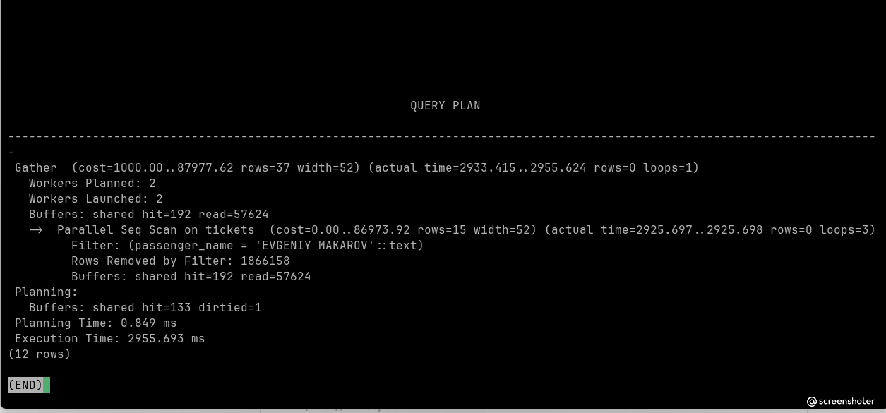

#### Создание индекса и актуализация статистики
Создан стандартный B-tree индекс по полю `passenger_name` и выполнен сбор статистики командой `ANALYZE`.

```sql
CREATE INDEX idx_passenger_name ON tickets (passenger_name);
ANALYZE tickets;
```

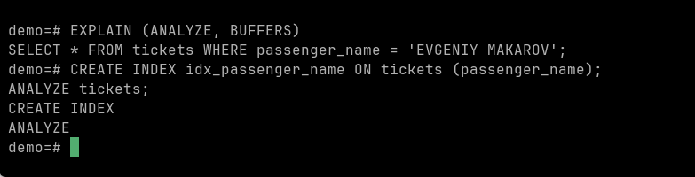

#### Состояние после создания индекса
Повторно запущен тот же запрос для оценки изменений в плане.

**План выполнения (после индекса):**
```text
Bitmap Heap Scan on tickets (cost=4.71..146.47 rows=36 width=52) (actual time=0.498..0.498 rows=0 loops=1)
  Recheck Cond: (passenger_name = 'EVGENIY MAKAROV'::text)
  Buffers: shared read=3
  -> Bitmap Index Scan on idx_passenger_name (cost=0.00..4.70 rows=36 width=0) (actual time=0.104..0.104 rows=0 loops=1)
        Index Cond: (passenger_name = 'EVGENIY MAKAROV'::text)
        Buffers: shared read=3
Planning Time: 0.429 ms
Execution Time: 0.537 ms
```

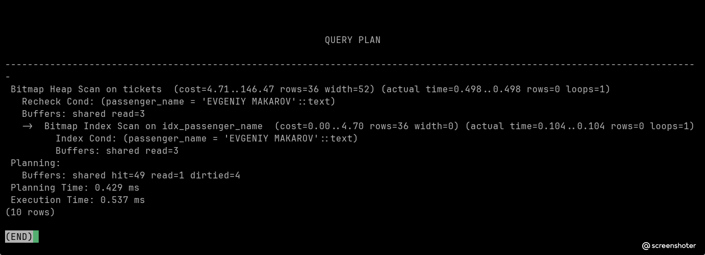

**Комментарий:** Стандартный B-tree индекс идеально подходит для поиска по точному равенству и диапазонам. Его применение ускорило поиск с **2955.693 мс** до **0.537 мс** (более чем в **5500 раз**). Без индекса PostgreSQL читал всю таблицу в три параллельных потока (**57 624** страницы с диска), с индексом — обратился всего к **3** страницам.

---

### 2. GIN-индекс для полнотекстового поиска

#### Подготовка таблицы и создание GIN-индекса
Для реализации полнотекстового поиска в таблицу `tickets` добавлена специальная колонка `fio_lexeme` типа `tsvector`. Поле заполнено нормализованными лексемами на основе `passenger_name`, после чего построен инвертированный индекс `GIN` и обновлена статистика.

```sql
ALTER TABLE tickets ADD COLUMN fio_lexeme tsvector;
UPDATE tickets SET fio_lexeme = to_tsvector('russian', passenger_name);
CREATE INDEX idx_fio_gin ON tickets USING GIN (fio_lexeme);
ANALYZE tickets;
```

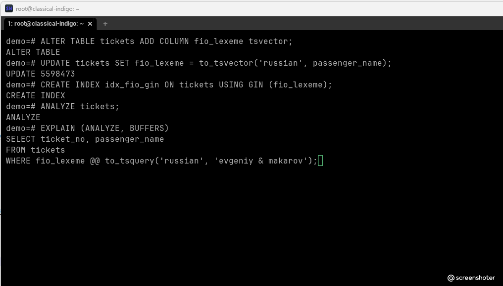

#### Проверка полнотекстового поиска
```sql
EXPLAIN (ANALYZE, BUFFERS)
SELECT ticket_no, passenger_name
FROM tickets
WHERE fio_lexeme @@ to_tsquery('russian', 'evgeniy & makarov');
```

**План выполнения:**
```text
Bitmap Heap Scan on tickets (cost=30.03..34.04 rows=1 width=27) (actual time=0.634..3.403 rows=45 loops=1)
  Recheck Cond: (fio_lexeme @@ '''evgeniy'' & ''makarov'''::tsquery)
  Heap Blocks: exact=24
  Buffers: shared hit=14 read=22
  -> Bitmap Index Scan on idx_fio_gin (cost=0.00..30.03 rows=1 width=0) (actual time=0.167..0.167 rows=45 loops=1)
        Index Cond: (fio_lexeme @@ '''evgeniy'' & ''makarov'''::tsquery)
        Buffers: shared hit=12
Planning Time: 2.304 ms
Execution Time: 3.433 ms
```

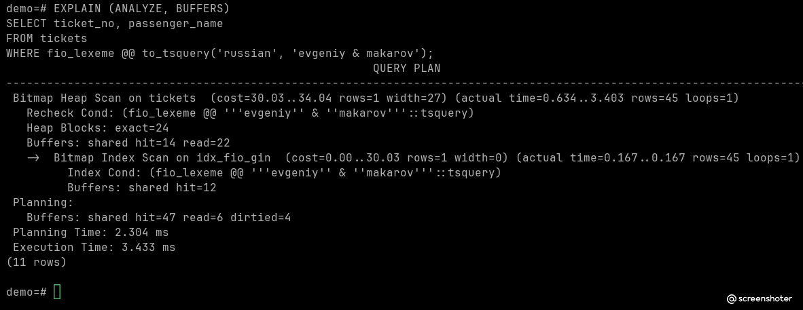

**Комментарий:** Обобщённый инвертированный индекс (`GIN`) индексирует отдельные слова (лексемы) внутри составных значений. Он позволяет быстро искать записи по вхождению слов независимо от их порядка в строке. Поиск 45 совпадений по 5.59 млн строк занял всего **3.433 мс**.

---

### 3. Функциональный индекс (на поле с функцией `lower`)

#### Состояние до создания индекса
Обычный индекс не работает, если к столбцу в условии `WHERE` применяется функция. Регистронезависимый поиск через `lower(passenger_name)` привел к полному сканированию таблицы.

**План выполнения (до индекса):**
```text
Gather (cost=1000.00..161713.99 rows=16163 width=85) (actual time=216.134..2900.949 rows=45 loops=1)
  Workers Planned: 2
  Workers Launched: 2
  Buffers: shared hit=4796 read=134098
  -> Parallel Seq Scan on tickets (cost=0.00..159097.69 rows=6735 width=85) (actual time=141.076..2837.065 rows=15 loops=3)
        Filter: (lower(passenger_name) = 'evgeniy makarov'::text)
        Rows Removed by Filter: 1866143
        Buffers: shared hit=4796 read=134098
Planning Time: 0.236 ms
Execution Time: 2901.219 ms
```

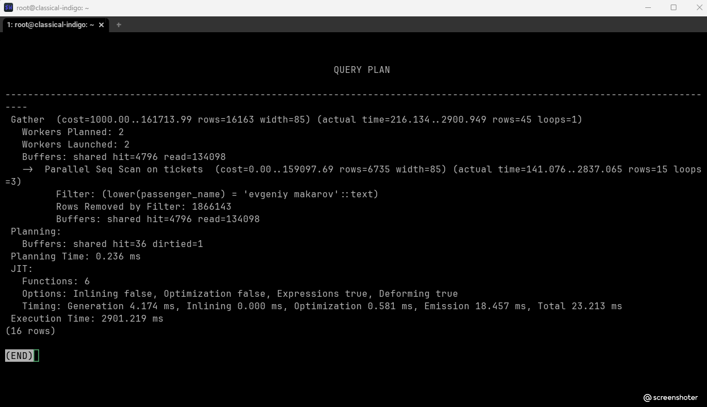

#### Создание функционального индекса и проверка
Создан индекс непосредственно от результата выражения `lower(passenger_name)`.

```sql
CREATE INDEX idx_lower_name ON tickets (lower(passenger_name));
ANALYZE tickets;

EXPLAIN (ANALYZE, BUFFERS)
SELECT * FROM tickets WHERE lower(passenger_name) = 'evgeniy makarov';
```

**План выполнения (после индекса):**
```text
Bitmap Heap Scan on tickets (cost=4.73..159.36 rows=39 width=85) (actual time=0.059..0.107 rows=45 loops=1)
  Recheck Cond: (lower(passenger_name) = 'evgeniy makarov'::text)
  Heap Blocks: exact=24
  Buffers: shared hit=24 read=3
  -> Bitmap Index Scan on idx_lower_name (cost=0.00..4.73 rows=39 width=0) (actual time=0.051..0.051 rows=45 loops=1)
        Index Cond: (lower(passenger_name) = 'evgeniy makarov'::text)
        Buffers: shared read=3
Planning Time: 0.349 ms
Execution Time: 0.125 ms
```

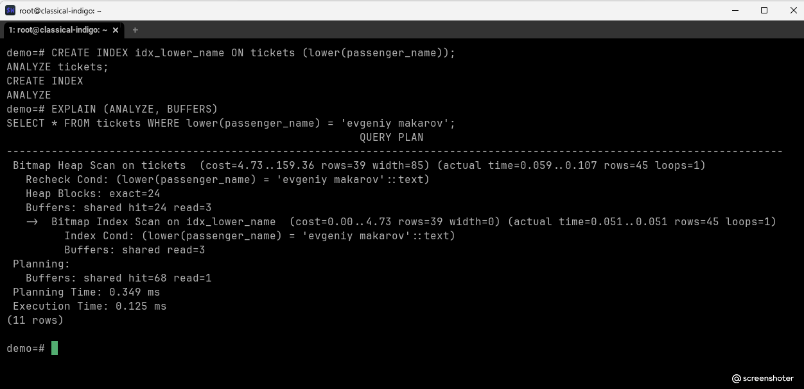

**Комментарий:** Функциональный индекс хранит в B-tree уже предвычисленные значения в нижнем регистре. Это избавило СУБД от необходимости вызывать функцию `lower()` для каждой из 5.59 млн строк и читать **134 098** страниц с диска. Время запроса сократилось с **2901.219 мс** до **0.125 мс** (ускорение в **23 200 раз**).

---

### 4. Составной индекс на несколько полей `(book_ref, passenger_id)`

#### Исходное состояние
При проверке запроса по двум полям до создания нашего индекса выяснилось, что в демо-базе уже существует системный уникальный индекс `tickets_book_ref_passenger_id_outbound_key`, который планировщик использовал по умолчанию (**0.452 мс**).

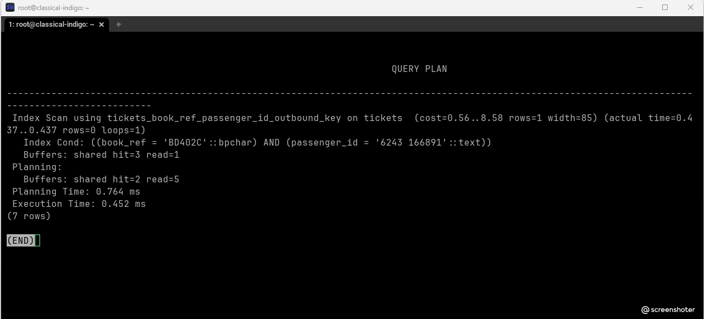

#### Создание составного индекса и проверка по двум полям
```sql
CREATE INDEX idx_book_pass ON tickets (book_ref, passenger_id);
ANALYZE tickets;

EXPLAIN (ANALYZE, BUFFERS)
SELECT * FROM tickets WHERE book_ref = 'BD402C' AND passenger_id = '6243 166891';
```

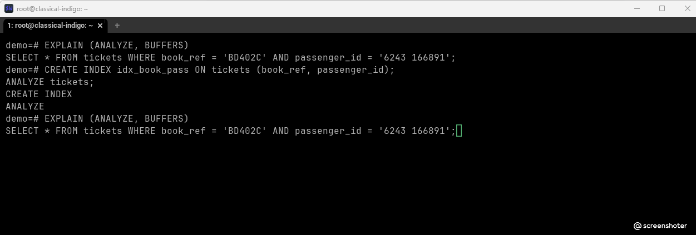

**План выполнения:**
```text
Index Scan using idx_book_pass on tickets (cost=0.43..8.45 rows=1 width=85) (actual time=0.492..0.493 rows=0 loops=1)
  Index Cond: ((book_ref = 'BD402C'::bpchar) AND (passenger_id = '6243 166891'::text))
  Buffers: shared read=3
Planning Time: 0.454 ms
Execution Time: 0.513 ms
```

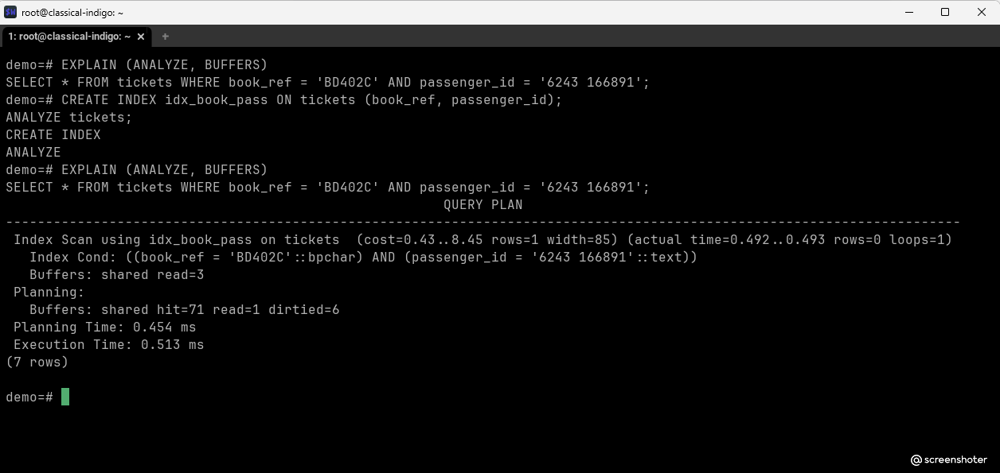

#### Тест 4.2: Поиск только по первой колонке (`book_ref`)
```sql
EXPLAIN (ANALYZE, BUFFERS)
SELECT * FROM tickets WHERE book_ref = 'BD402C';
```

**План выполнения:**
```text
Index Scan using idx_book_pass on tickets (cost=0.43..40.59 rows=9 width=85) (actual time=0.018..0.018 rows=0 loops=1)
  Index Cond: (book_ref = 'BD402C'::bpchar)
  Buffers: shared hit=3
Planning Time: 3.030 ms
Execution Time: 0.056 ms
```

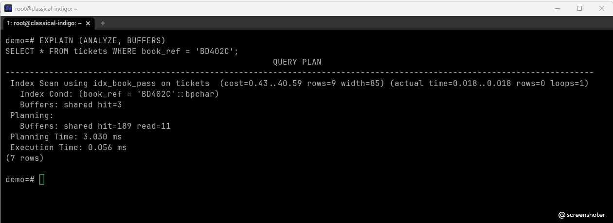

#### Тест 4.3: Поиск только по второй колонке (`passenger_id`)
```sql
EXPLAIN (ANALYZE, BUFFERS)
SELECT * FROM tickets WHERE passenger_id = '6243 166891';
```


**План выполнения:**
```text
Index Scan using idx_book_pass on tickets (cost=0.43..129408.27 rows=4 width=85) (actual time=411.080..411.081 rows=0 loops=1)
  Index Cond: (passenger_id = '6243 166891'::text)
  Buffers: shared hit=2 read=21745
Planning Time: 0.339 ms
Execution Time: 427.958 ms
```

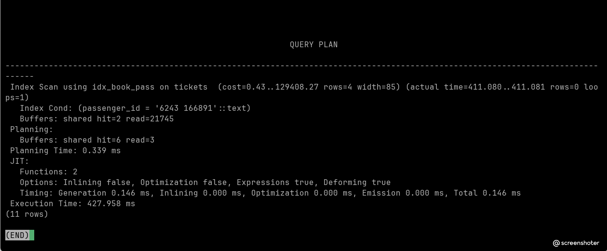

**Комментарий:** Составной B-tree индекс сортирует данные сначала по первому полю (`book_ref`), и только внутри одинаковых значений — по второму (`passenger_id`). Поэтому он максимально эффективен при фильтрации по обоим полям (**0.513 мс**) или только по ведущему полю (**0.056 мс**). При поиске только по второму полю планировщик применил `Index Scan`, но ему пришлось прочитать весь индекс целиком с диска (**21 745** страниц), что заняло **427.958 мс** (почти в 850 раз медленнее).

---

