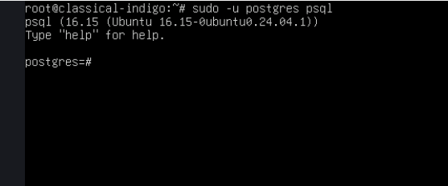
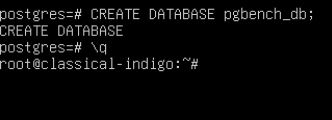
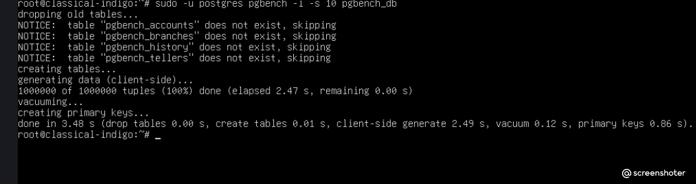
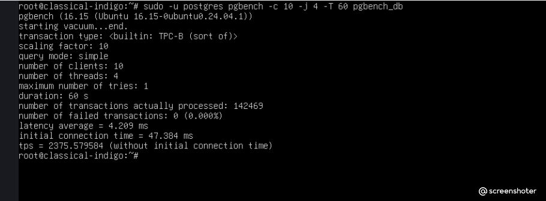
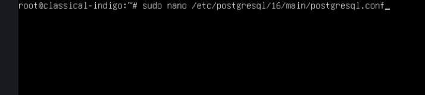
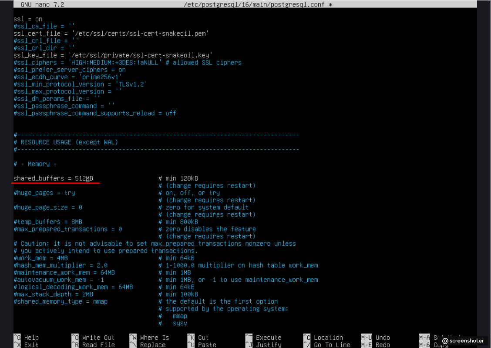
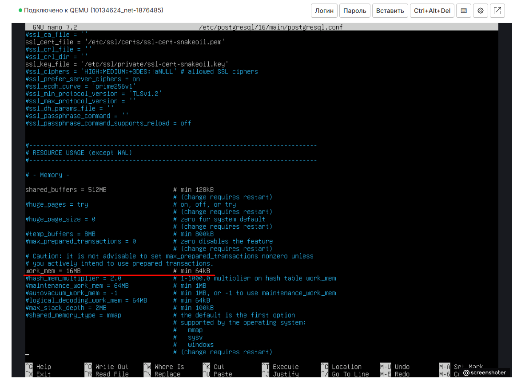
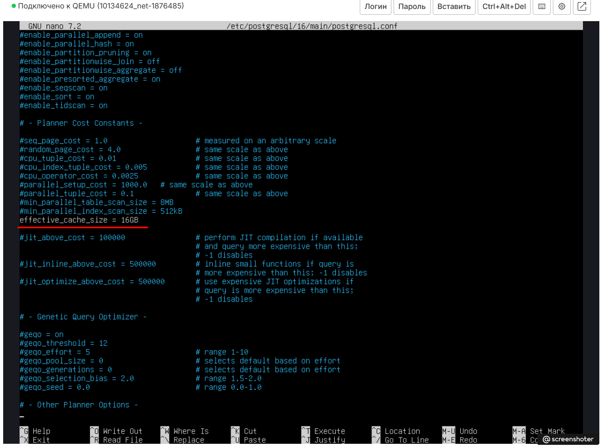
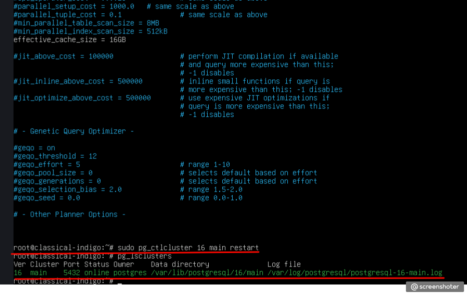
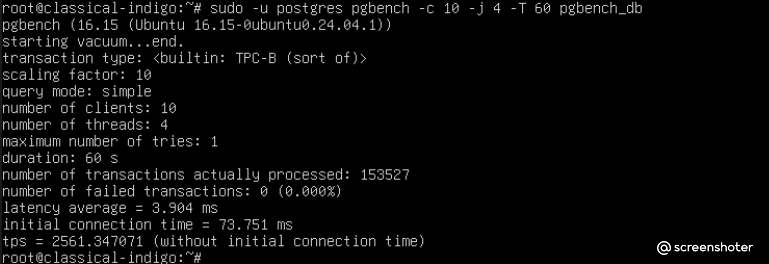

# Домашнее задание 4: Pgbench и базовый тюнинг

## Цель
Повысить производительность PostgreSQL на тестовом стенде для быстрой оценки эффекта тюнинга конфигурации под нагрузкой.

## Ход выполнения

## Условия теста
- **База данных:** `pgbench_db`
- **Масштаб (scale):** 10
- **Длительность:** 60 секунд
- **Клиенты:** 10
- **Потоки:** 4
- **Версия PostgreSQL:** 16
- **ОЗУ сервера:** 2 ГБ

## Ход выполнения


### 1. Инициализация тестовой базы
Создана база `pgbench_db` и заполнена тестовыми данными с помощью `pgbench -i -s 10`.

```bash
sudo -u postgres psql
CREATE DATABASE pgbench_db;
\q
sudo -u postgres pgbench -i -s 10 pgbench_db
```








### 2. Baseline-прогон (до тюнинга)
Выполнен замер производительности с настройками по умолчанию.

```bash
sudo -u postgres pgbench -c 10 -j 4 -T 60 pgbench_db
```




Результат baseline: TPS = 2375.579584 (without initial connection time).

### 3. Изменение параметров конфигурации
В файле /etc/postgresql/16/main/postgresql.conf изменены следующие параметры:

Параметр	            Было	Стало	Обоснование
shared_buffers	        128MB	512MB	Увеличен кэш данных в памяти. Для 2 ГБ ОЗУ значение 512 МБ (25%) является безопасным и эффективным.
work_mem	            4MB	    16MB	Увеличен объём памяти для операций сортировки и хеширования, которые активно используются в тесте TPC-B.
effective_cache_size	4GB	    1GB	    Скорректирована оценка кэша ОС в соответствии с реальным объёмом памяти сервера (2 ГБ).

После изменений кластер перезапущен командой sudo pg_ctlcluster 16 main restart.











### 4. Повторный прогон (после тюнинга)
Выполнен замер с теми же настройками, что и baseline.

```bash
sudo -u postgres pgbench -c 10 -j 4 -T 60 pgbench_db
```




Результат после тюнинга: TPS = 2561.347071 (without initial connection time).


Результат после тюнинга: TPS = 2561.347071 (without initial connection time).

Сравнение и вывод
Этап	            TPS	                  Прирост
Baseline (до)	    2375.579584	            —
После тюнинга	    2561.347071	            +7.8%

Вывод: Изменение параметров shared_buffers и work_mem позволило увеличить количество транзакций в секунду на 7.8%. Основной вклад внёс рост shared_buffers, так как увеличил долю данных, обрабатываемых в оперативной памяти, снизив нагрузку на диск. Параметр work_mem также сыграл роль, ускорив сортировки в запросах. Для сервера с 2 ГБ ОЗУ дальнейшее увеличение shared_buffers свыше 512 МБ нецелесообразно из-за риска нехватки памяти для самой ОС и других процессов.